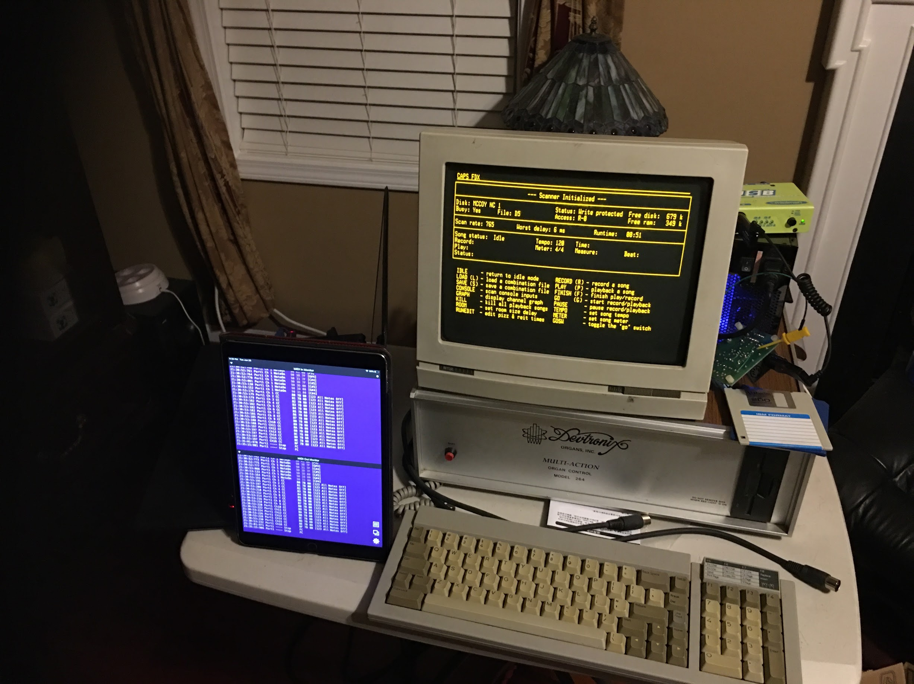
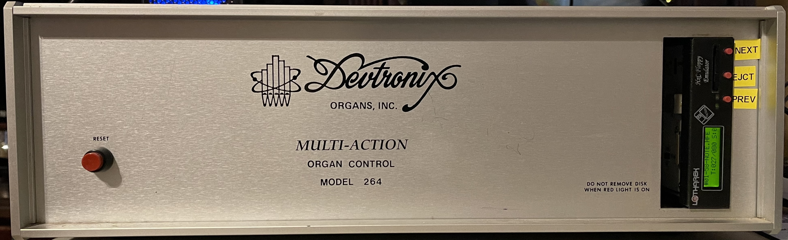

# Devtronix Model 264

This repository contains reverse engineering and analysis of the 
Devtronix Model 264, a Motorola 68000-based pipe-organ
**relay and combination action with a record/playback facility**, from its boot ROM
and floppy diskettes. The 264's computer is Devtronix's own board, built to reflect 
the design of the [Alpha Microsystems](https://en.wikipedia.org/wiki/Alpha_Microsystems)
68000-based systems, and is one of the few 68Ks that are *little-endian*: Alpha
Micro wired its 68000 machines with the data-bus bytes swapped to stay
compatible with the little-endian WD16 of its earlier AM-100 line (see Cameron
Kaiser's 
[Alpha Micro AM-1000E and AM-1200
refurb](https://oldvcr.blogspot.com/2026/03/refurb-weekend-double-header-alpha.html)
for a hands-on account of these machines).

Most, if not all of the Devtronix firmware and system monitor were written by 
Dick Wilcox and Tim Rickman, both recipients of the
[American Theatre Organ Society (ATOS) Award for Industry Achievement](https://www.atos.org/programs-awards/industry-achievement).

Pipe organs are fascinating machines. I believe you will agree
when you understand how their relays operate internally.
These used to be electro-mechanical, and the Devtronix was
the one of the first computerized & programmable organ relays.

----



---



---

## About this project

Allow me to introduce myself. I'm Chris McCoy, and I'm helping my dad, Gerald
(Jerry) McCoy, document the Devtronix Model 264 for himself and for others. Jerry is
a master pipe-organ technician and a former caretaker of the
[Nethercutt Collection](https://nethercuttcollection.org/the-collection/music-room/)
in Sylmar, California. He knew both Dick Wilcox and Tim Rickman
personally and worked with them on product development, installations and bug
hunting through the 1980s and 1990s. Dick and Tim have both since passed away.

_San Sylmar_ as it was once known, has been encoding performances of both the
Mighty Wurlitzer and the accompanying Bösendorfer Concert Grand Piano since the
late 1970s.  Many artists and masters of their craft have performed there,
using [9-track Tape](https://en.wikipedia.org/wiki/9-track_tape)
originally!

The aim is to recover and preserve the performances recorded on the Devtronix
diskettes I have from several different pipe organs, and that has mostly been
done: every recording now renders to a standard MIDI file that will play on
[Hauptwerk](https://www.hauptwerk.com/).  Many of the artists that performed
and encoded using this system are no longer with us.  It would be a tragedy for
any performances to be lost to time, obscure systems and degraded media.

---

## Retrieving the firmware and system monitor

The floppy images were captured with a [KryoFlux](https://kryoflux.com/?page=kf_features)
(a proprietary cousin of the Greaseweazle, which I'm sure would do just as well) and a
[Samsung SFD-321B](https://floppy.cafe/resources/SAMSUNG-SFD321B-070103.pdf) drive; the
pair read and dumped the Model 264 format without trouble, though it took several
drives to find one that would. Many of the floppies are deteriorating quickly, so the
machine now boots from an
[HxC SD-card floppy emulator](https://hxc2001.com/floppy_drive_emulator/#SDCARDFloppyemulator)
instead.

The boot ROMs were dumped with a [Bus Pirate](https://buspirate.com/), luckily
before I plugged both chips in upside down and destroyed them. 🤦 I was able to recover
from that and bring the machine back to life.

---

Start with **[docs/README.md](docs/README.md)**, the one-page summary of what was
found, with links to the detailed write-ups:

- [boot-rom/](boot-rom/README.md): the boot ROM, annotated disassembly, memory and I/O maps
- [system-monitor/](system-monitor/README.md): the operating software, the file system,
  the Track, Definition and Combination file formats, and the tools that read them

## Acknowledgements

My sincere thanks to Jim Gallops, whose company carries the Devtronix system
forward today, for kindly giving his permission to document the Devtronix Model
264 here, including photographs of its Devtronix boards. His
generosity made it possible to share this work openly, and it means a great deal
to my dad and me. I hope this record does justice to the system Dick and Tim built.

## Links

- [devtronix.org](https://devtronix.org/): Dominic Cheshire's Devtronix organ fan site and repository.
- [Alpha Micro AM-1000E and AM-1200 refurb](https://oldvcr.blogspot.com/2026/03/refurb-weekend-double-header-alpha.html): Cameron Kaiser's hands-on account of the computer the 264 is built on.
- [ampm.floodgap.com](https://ampm.floodgap.com/): Cameron Kaiser's Alpha Micro site, served from a real Alpha Micro, with the company's history and a list of its models.

## Conversion tools

The tools are Python 3, managed with [uv](https://docs.astral.sh/uv/): dependencies are in
`pyproject.toml` and locked in `uv.lock`.

```
uv sync                                   # one-time: create .venv with the locked packages
uv run system-monitor/devfs.py SIDE0 SIDE1   # run any tool
```

## What is not in this repository

The floppy disk images, the flux dumps, the HFE images, the decoded sector images
and the rendered MIDI files are deliberately left out (`disk-images/`,
`decoded-images/`, `renders/`) until permission to publish the recordings is
settled. Links into those folders from the write-ups will not resolve here. The
tools work on a local copy that has them.  Publishing the artists' work to the
world wouldn't be a good move on my part.  

If you have any works on the Model 264, contact me.

