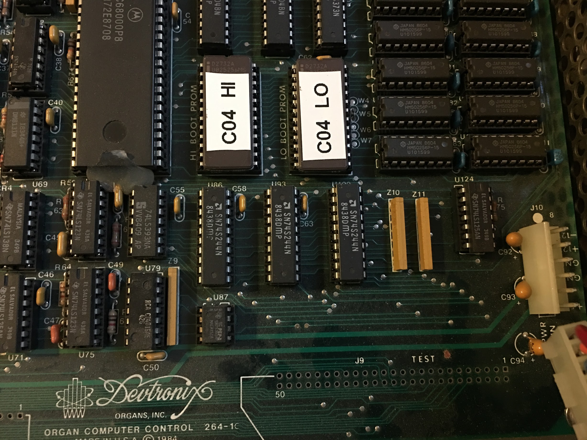
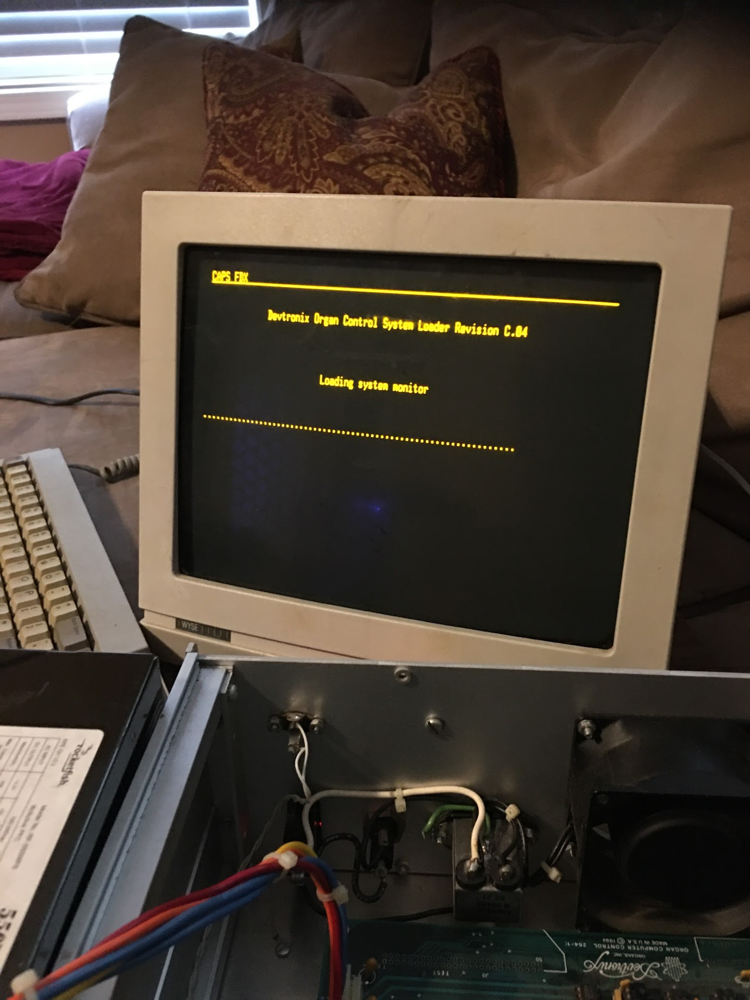

# Devtronix Model 264 — boot ROM ("Loader Revision C.04")

Reverse-engineering notes for the boot ROM of the Devtronix Model 264 pipe-organ
relay. Everything here was derived from the Bus Pirate ROM dump in
`../devtronix-hardware/devtronix-rom/` and cross-checked against the floppy images in
`../disk-images/`.

## Files

| File | What it is |
|---|---|
| `loader-c04.bin` | 2048-byte big-endian 68000 image, ready for any 68k disassembler |
| `loader-c04.asm` | Fully annotated disassembly (read this) |
| `loader-c04.raw-sweep.txt` | Mechanical capstone sweep, kept as the reference the annotation was built from |
| `mkrom.py` | Rebuilds `loader-c04.bin` from `devtronix.rom.merged` (byte swap) |
| `disasm.py` | Linear-sweep 68000 disassembler (capstone) with data-range support |
| `devdisk.py` | Reads a floppy image the way the ROM does; parses boot block, file header, extents |

Python dependencies are declared in `../pyproject.toml` and locked in `../uv.lock`; run scripts with `uv run` from anywhere in the project.



*The CPU board, "Organ Computer Control 264-1", Devtronix Organs 1984: the MC68000P8 at
the left, the two 2732A EPROMs labelled "C04 HI BOOT PROM" and "C04 LO BOOT PROM" that
this folder decodes, and the HM50256 DRAMs of the 512 KB main memory at the right.*

## Headline facts

- **CPU:** MC68000P8 at 8 MHz on Devtronix's own board, "Organ Computer Control 264-1"
  (1984), built to the Alpha Micro design (see `../docs/README.md`, References). Reset SSP
  `$0007F000`, reset PC `$00800008`.
  The system monitor on disk mentions a "Dimension-030 Turbo Mode", so a 68030
  accelerator option existed.
- **ROM** at `$800000`. The loader occupies `$800000-$8005EF`; the rest of the 2 KB
  dump is `$FF`.
- **The ROM dump covers 2 KB of an 8 KB pair.** The photo above settles it: the boot
  PROMs are two 2732A EPROMs (4K x 8 each, high and low byte), 8 KB in all. The dumper
  (`devtronix.py`) only read addresses `$000-$3FF` (1024 words = 2 KB), though it can
  drive 12 address bits, and the loader copies **8000 bytes** of ROM to RAM at
  start-up. Re-dump `$400-$FFF` to see whether anything follows the loader.
- **The loader relocates itself** to RAM at `$07E000` and runs there (so it can patch
  a terminal escape-sequence template in place). Stack is just below it.

## Byte order — read this before touching any dump

On this machine **strings are in byte-address order but 16-bit words are stored
low byte first**. Concretely, in `devtronix.rom.merged` and in every floppy image:

- `Devtronix Organ Control System Loader` reads straight through.
- 68000 opcodes appear byte-swapped: `RTS` is `75 4E`, `JSR d16(PC)` is `BA 4E`.
- A longword is two little-endian words, high word first (`0007 F000` for `$0007F000`).

This is not a dumping artifact. The floppy images (flux-level KryoFlux captures) show
exactly the same relationship, and the loader's own code depends on it: the cursor
positioning routine does a `ror.w #8` before storing a (row,col) word into a byte
template, which is only correct if a word's low byte lands at the lower address.

Practical rule:
- **To disassemble:** swap the two bytes of every word (`mkrom.py` does this for the ROM).
- **To read strings or byte tables:** use the image as-is.
- **To read a 16-bit field** (sector numbers, addresses): little-endian.

This is how Alpha Micro built all its 68000 machines: the address lines are flipped so
that 16-bit values keep the layout of the company's earlier WD-16 systems (see
`../docs/README.md`, References).

## Memory map (as used by the loader)

| Address | Use |
|---|---|
| `$000000-$0003FF` | 68000 exception vectors. Loader zeroes `$0000` up to the monitor's load address |
| `$000044.w` | Left for the loaded program: DUART CSR codes, high byte = channel B, low byte = channel A |
| `$000046.b` | Left for the loaded program: `$FF` if the console terminal is on channel B |
| `$001032` | Where the System Monitor 2.6 loads and starts (from the monitor disk's boot block) |
| `$040000` | 1 KB sector buffer for boot block and file header |
| `$07E000` | Relocated loader; stack grows down from here |
| `$07F000` | Reset-time SSP |
| `$800000` | Boot ROM (this loader) |
| `$FFFFFE00` | Write: the Alpha Micro board's two-digit LED display (see codes below); AMOS shows its own boot codes on it. Not the console's "File #" display |
| `$FFFFFE03` | Read once at reset, value discarded. Unknown |
| `$FFFFFE21-$FFFFFE3F` | MC68681 DUART, registers on odd bytes. Channel A = terminal, channel B = modem |
| `$FFFFFFE0-$FFFFFFE7` | Floppy subsystem (WD179x-compatible controller plus glue), see below |

### DUART (MC68681 at `$FFFFFE21`)

Register offsets are the standard 68681 map times 2 (odd bytes): MR at +0, SR/CSR at
+2, CR at +4, RHR/THR at +6, ACR at +8; channel B at +$10. Both channels are set to
8N1. ACR = `$80` selects baud-rate set 2, so CSR `$BB` = 9600, `$88` = 2400, `$66` = 1200.

### Floppy (`$FFFFFFE0`)

| Address | Direction | Meaning |
|---|---|---|
| `$FFE0` | R/W | FDC status / command (WD179x: `$08` restore, `$18` seek, `$84` read sector) |
| `$FFE2` | W | FDC sector register |
| `$FFE3` | W | FDC data register (seek target cylinder) |
| `$FFE4` | R | Sector data port; a byte read stalls until the FDC has data |
| `$FFE5` | W | Clear interrupt/DRQ latch |
| `$FFE6` | W | Drive/side latch: `$A1` = side 0, `$B1` = side 1, `$00` = off |
| `$FFE6` | R | Bit 1 = FDC INTRQ |
| `$FFE7` | W | `$80` = FDC running, `$00` = FDC reset |

### Status display codes (`$FFFFFE00`)

| Code | Meaning |
|---|---|
| `00` | Reset |
| `A1` | Probing terminal on channel A at 9600 |
| `B1` `B2` `B3` | Probing channel B at 9600 / 2400 / 1200 |
| `C1` | No terminal answered, auto-booting |
| `nn` | Logical sector number currently being read |
| `EE` | Floppy read error (retrying) |

## Boot flow

1. Reset: display `00`, copy ROM `$800038..` (8000 bytes) to `$07E000`, jump there.
2. Program the DUART. Auto-detect a terminal: ring BEL on channel A at 9600, then
   channel B at 9600, 2400, 1200, each time waiting about 300000 polls for an **ESC**.
   Any other key rings again.
3. Terminal found: show the banner and the menu
   `Hit return to boot from disk:` / `Hit $ to download across modem:`.
   No terminal: print to channel A anyway and boot from disk.
4. Boot from disk: read logical sector 0 into `$40000`.
   - Byte 1 == `$F2`: it is a system disk. Byte 0 bit 0 = double sided. Word `$36` =
     logical sector of the system monitor's file header, word `$38` = load address.
     Zero RAM below the load address, follow the header's extent list, load 1 KB
     sectors from the load address upward, store console info at `$44/$46`, jump to the
     load address. Header sector 0 → `?No system monitor on this disk`, back to the menu.
   - Otherwise: load logical sector 1 to address `$0` and jump to `$0` (a raw
     "autoboot" disk).
5. `$` download: receive a 4-byte end address then 1 KB blocks from address 0. Block =
   SOH, data, 8-bit sum; loader replies `G` (good) or `E` (resend). Then waits for ESC
   and jumps.



*What the loader shows: the banner at row 2, "Loading system monitor" at row 7, and
one dot per sector as the monitor's 73 sectors come off the floppy. The terminal is a
Wyse; the open case below it shows the fan and the edge of the CPU board.*

Terminal output uses TeleVideo/ADM-3A sequences (`ESC =` cursor address, `ESC Y`,
`ESC T`, `ESC . 0`). Strings embed control bytes: `$81 row col`, `$82` CRLF, `$C1`
clear to end of screen, `$C2` clear to end of line.

## Floppy format (from the ROM, verified on the system monitor disk)

- 1024-byte sectors, 5 per track, sectors numbered 1–5. 80 cylinders, 2 sides →
  800 sectors, 800 KB. The `*_s0`/`*_s1` files are per-side images (409600 bytes each);
  `*.img` is side 0 followed by side 1.
- Logical sector *n*: track = n / 5, sector = n % 5 + 1. Double sided: cylinder =
  track / 2, side = track & 1. So sectors 0–4 are cyl 0 side 0, 5–9 cyl 0 side 1, …
- Boot block (logical 0): byte 0 flags (bit 0 double sided), byte 1 `$F2`, `$1C`
  volume label (`CMM` on the monitor disk), `$36` monitor header sector, `$38` load
  address. Bytes from `$200` look like an allocation bitmap; not yet confirmed.
- File header sector: `+4` NUL-terminated name (`System Monitor 2.6 (183) `),
  `+$40` extent list of (start, length) word pairs, start 0 terminates.

`devdisk.py` reproduces this and extracts the monitor:

```
uv run devdisk.py ../disk-images/system-monitor-v189/system-monitor-v189_s0 \
    ../disk-images/system-monitor-v189/system-monitor-v189_s1 --extract monitor.bin
```

Result: header at logical sector 1, one extent (2, 73) = 74752 bytes loaded at `$1032`.
Byte-swapped, the monitor begins `lea 0(pc),a5 ; bra.s` past the version strings
`2.6 (183)` and `05/11/93`. The disk labelled v189 contains v183, as noted in
`disk-images-list.txt`.

## Open questions / next steps

1. Re-dump ROM addresses `$400-$FFF` (change `range(0x0000,0x0400)` in `devtronix.py`);
   the EPROMs are 2732As, so there are 6 KB still unread.
3. Identify `$FFFFFE03` on the schematic (`$FFFFFE00` is the board's LED display).
4. Disassemble the System Monitor 2.6 (183): it owns the filesystem, the relay I/O
   scanning, MIDI, and the record/playback file format the music disks use.
5. Catalogue the music disks (`58-note-*`, `jerrystour`, `mccoy*`, `stephen-ross-copy`,
   `r-rhode-conc`, …) with `devdisk.py` once the directory structure is understood.
