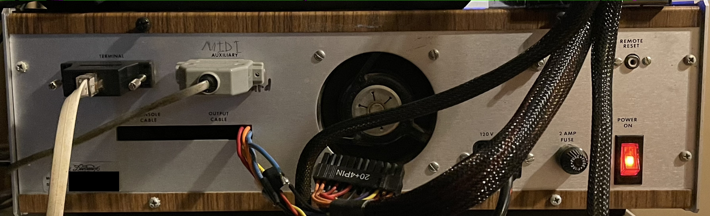

# Devtronix Model 264 — what has been found

The Devtronix Model 264 is a pipe-organ relay and combination action with a
record/playback facility, built around a Motorola 68000. This project reverse
engineers it from a 2011 Bus Pirate dump of its boot ROM and 2020 flux-level
dumps of its floppies, so that the performances recorded on those floppies can
be recovered. This file is the index and the one-page summary; the detailed
write-ups are linked from each section.

| Folder | Contents |
|---|---|
| [`../boot-rom/`](../boot-rom/README.md) | Boot ROM ("Loader Revision C.04"): annotated disassembly, memory and I/O maps, disk reader |
| [`../system-monitor/`](../system-monitor/README.md) | The operating software (System Monitor 2.6): disassembly, file system, file formats, all tools |
| [`../system-monitor/COMMANDS.md`](../system-monitor/COMMANDS.md) | Every command the monitor's terminal accepts |
| `../renders/INDEX.md` | Catalogue of every recording, rendered to MIDI (not in the public repository) |
| `../decoded-images/` | Sector images decoded from the flux dumps, plus every HFE image (not in the public repository) |
| [`emulator.md`](emulator.md) | What an emulator of the 264 needs: every device's expected behaviour, the byte-order rule, stages, and which framework |
| [`definition-links.md`](definition-links.md) | Diagrams of how a definition's lists link together: what switches a function on, and what an active function does with keys |

Python tools run with `uv run script.py ...` (dependencies are in `../pyproject.toml`, locked in `../uv.lock`; `uv sync` creates the environment).
The disk images (`disk-images/`), decoded images and renders are kept out of the
public repository until the recordings can be published; the write-ups refer to them
as they exist in a local copy. Nothing under `disk-images/` is ever modified.

## The machine

- **Computer** Devtronix's own board, "Organ Computer Control 264-1" (1984), built to
  the design of the Alpha Microsystems AM-1000: MC68000P8 at 8 MHz, SCN68681 DUART,
  6840 timer, WD2791 floppy controller, and the Alpha Micro byte-swapped bus. The
  "Dimension-030" is InterLink Systems' 1991 68030 accelerator for Alpha Micro
  machines, and the monitor's "Turbo Mode" enables its instruction cache with
  `movec CACR`, exactly as Alpha Micro's own TURBO utility does. Physically the
  Dimension-030 is a board that plugs into the 68000's socket and carries the 68030
  plus two SIMM slots of its own RAM (Kaiser's article shows one fitted), which is
  why the monitor, once its `movec` probe succeeds, goes on to size memory above
  512 KB.
- **The PC-hosted 264: the Falcon.** Besides the console-and-floppy machine in the
  photos, the 264 also ran inside an IBM PC compatible, built
  on Alpha Micro's **Falcon card**: an ISA card carrying a 68030, a
  68000-series CPU running the same byte-swapped code, that let "standard DOS and
  later Windows-based PCs" run 68K software, with the PC supplying console, disks
  and file transfer through Alpha Micro's AMPC utility. Alpha Micro had sold its
  system that way twice before, as the AM-170 AMOS/L board in the 1985 AM-680 "Entry
  Level System" (an AM-1000 on an ISA card) and the AM-1200CS card of 1988, which the
  Falcon replaced in the 1990s. The monitor carries the software side of this
  configuration: terminal type 5 is "Devtronix PC terminal program", drive 3 is "PC
  disk" served over the serial link (`Topc`, `Frompc`, `Pcdisk`, the PCL task), and
  when the console answers on channel B the other channel becomes a 38400-baud PC
  link. Monitor 189 (06/01/94) is from the Falcon's era.
- **Memory** 512 KB RAM at `$000000` (sixteen HM50256 DRAMs); 8 KB boot ROM at
  `$800000` (two 2732A EPROMs, high and low byte).
- **I/O** MC68681 DUART at `$FFFFFE21` (channel A = terminal, 9600 baud;
  channel B = modem, 1200 baud), MC6840 timer at `$FFFFFE11` (1 ms tick, tempo
  clock), WD179x floppy controller with glue at `$FFFFFFE0`, console scanner
  (input boards, magnet output boards, swell-shoe A/D) at `$FFFFFF80`, and the
  Alpha Micro board's two-digit LED display at `$FFFFFE00`, on which the loader
  shows its progress codes and then the sector being read (AMOS uses the same
  display for its own codes, "b" for no boot device, "5b" while sensing baud).
- **MIDI** on DUART channel B at 31250 baud, clocked from the chip's timer on the
  8 MHz CPU clock. MIDI notes are ordinary I/O addresses whose board letter is `M`
  (`MA-E5` = channel 1, note 36), used on rank outputs throughout the collection: the
  58-note player drives a MIDI instrument, the McCoy organ is entirely MIDI divisions,
  and the tour-disc definitions carry a 16-channel orchestra.
- **Terminal** a serial terminal on the DUART; the monitor has seven escape-sequence
  tables (`Term n`): TeleVideo 950 family, [Wyse WY-50](https://terminals-wiki.org/wiki/index.php/Wyse_WY-50)
  (the default on 45 of the 48 monitor images), an ADM-3A-class minimum, and Devtronix's
  own PC terminal program. The boot ROM itself speaks TeleVideo (`ESC =`, `ESC Y`, `ESC T`).

*The rear of the Model 264: the TERMINAL port (DUART channel A), the port relabelled
"MIDI AUXILIARY" by hand (channel B, the modem port the MIDI adapter plugs into), the
slots for the console and output ribbon cables, the fan, mains fuse and switch, and a
REMOTE RESET jack.*

### Byte order: read this before touching any dump

Strings are stored in byte-address order but **16-bit words are stored low
byte first**. Longs are two little-endian words, high word first. This is
visible in both the ROM dump and the flux-level floppy images, and the
firmware itself relies on it. Rules: swap the two bytes of every word before
disassembling; read strings as-is; read 16-bit fields little-endian. The reason
is the computer itself: the 264 is built on an
[Alpha Microsystems](https://en.wikipedia.org/wiki/Alpha_Microsystems) 68000
system, and Alpha Micro wired the 68000's data bus byte-swapped so that data
from its earlier little-endian WD16 machines (the AM-100 line) kept its layout.

## Boot ROM (Loader Revision C.04)

Relocates itself to RAM at `$07E000`, auto-detects a terminal by ringing BEL on
each port and baud rate and waiting for ESC, then offers "Hit return to boot
from disk" / "Hit $ to download across modem". Boot reads logical sector 0,
checks the `$F2` signature, finds the system-monitor file through a header
sector and an extent list, zeroes RAM below the load address, loads the file
and jumps to it. The modem path receives checksummed 1 KB blocks. The ROM is an
8 KB pair of 2732As; the loader occupies the first 1.5 KB and everything after it
has been confirmed to be `$FF`.

## System Monitor 2.6 (183), dated 05/11/93

74 KB of hand-written 68000 assembly: a small multitasking kernel (ten tasks,
62 system calls through `trap #0`, a 28-function disk service through
`trap #1`, a 1 ms timer wheel through `trap #3`), a text-window system, a
command line, the organ definition editor, the console scanner and relay
logic, and the recorder/player. Version 189 (06/01/94) is also on the disks and
is 93 % identical; nothing that matters for the music changed.

## File system

- 1024-byte sectors, 5 per track, 80 cylinders, 2 sides: 800 sectors, 800 KB.
  Logical sector *n* → track n/5, sector n%5+1; cylinder = track/2, side = track&1.
- Boot block (sector 0): `$F2` signature, volume label at `$1C`, boot pointer
  at `$36/$38`, **directory at `$6C`** (4-byte entries: slot number, slot letter,
  header sector), **allocation bitmap at `$200`**.
- Files live in *slots*: a letter and a number, `A4`, `T12`. The letter is the
  type: `A` system monitor, `D` organ definition, `C` combination (piston)
  settings, `T` track/song recording. `D1` and `C1` autoload; `C99` is the
  autosave slot. The console's two-digit "File #" display shows the slot number.
- Each file has a header sector: bytes used in the last sector at `+2`, name at
  `+4`, extent list of (first sector, count) word pairs at `+$40`.

`system-monitor/devfs.py` lists, checks and extracts; `fluxdecode.py` turns
KryoFlux streams or HFE files into sector images.

## File formats

- **Track / Song (`T`)**: a byte stream of time deltas (1/96 beat, 192 per
  second at the default tempo of 120, which is not stored in the file) and
  events: key on/off per keyboard, stop on/off, analog channel (swell shoe)
  values, MIDI passthrough, sync blocks carrying the full stop state, end of
  block, end of track. `devfs.py --events` decodes one.
- **Definition (`D`)**: a container of typed lists (keyboards, ranks, units,
  stops, links, functions, pistons, channels, ...). Keys and pipes share one
  121-note scale with note 25 = 8' C. A stop sounds a rank pipe at key + pitch
  offset through a link expression and a rank-output function. `devdef.py`
  dumps one like the editor's list commands. How the lists link together is
  drawn in [definition-links.md](definition-links.md).
- **Combination (`C`)**: 6-byte header, then per piston an OFF bitmap and an
  ON bitmap over the stops; their union is the piston's range. Decoded from the
  Set/Range/piston code. `devcomb.py` decodes one.
- `dev2midi.py` renders a track with its definition to a standard MIDI file,
  one channel per keyboard, or through stops and ranks with `--ranks`, which
  also plays the traps as General MIDI percussion, drives tremulants as
  modulation, follows the swell shades as expression, and applies the
  pizzicato and reiterate timing tables. With `--paramount` it writes a file
  for Hauptwerk's MIDI player with the Paramount 332 virtual theatre organ,
  mapping the registration onto that organ's stops
  ([paramount332-mapping.md](paramount332-mapping.md)).

## The collection

- The floppies were dumped in 2020 with a KryoFlux board and its DTC program, which
  saves the raw flux of every track (the archival copy) and also decodes it into a
  sector image. `fluxdecode.py` re-decodes the flux independently and agrees with DTC
  on every good sector.
- 58 image sets, 56 of them Devtronix system disks (many are duplicate dumps of
  the same floppy). Two are MS-DOS disks, not Devtronix. The two disks that existed
  only as HFE images are now decoded too: `os-backup` is "CMM 2" (both monitor
  versions and the same two definitions as `cmm-backup`) and `startupa` is
  "Startup A" (monitor 180 and one small four-keyboard definition); neither holds
  a recording.
- **844 track files**, all rendered: 1664 MIDI files in `renders/`, 41 tracks
  flagged for decode problems, 12 directory entries that are corrupt. Jerry's
  tour disc holds twelve named tunes (Danny Boy, Joy To The World, Stars And
  Stripes Forever, ...); the eighteen "58 Note Player" disks hold unnamed
  recordings for a one-keyboard roll player. "Danny Boy" and "Joy To The
  World" were checked note by note, and the renders have been listened to and
  sound right, which also confirms the 120 BPM tempo assumption.
- **94 definition entries, 50 distinct by content**, about eight real organs:
  Jerry's "OLD ORGAN DEFINITION" (11 keyboards, 710 stops, 60 ranks), the
  1995 tour disc (467 stops, 109 ranks), New Console 12-08-93 / 2-13-95 (417
  stops, 81 ranks), the PCC organ family (250 stops, 35 ranks, nine copies),
  McCoy's SCHANTZ 66 and OLD SWELL (142 stops, 70 ranks), and small test,
  player and MIDI-control definitions.
- **28 combination files** on the real-organ disks, none on the player disks.
  Several were saved under an older definition than the disk's `D1`.
- All 42 HFE images are gathered in `decoded-images/`. Four HFEs have 84 tracks
  because KryoFlux reads past cylinder 79; the format uses 80 and the extra
  tracks hold nothing.
- The side files (`*_s0`, `*_s1`) are per-side images, cylinder by cylinder;
  the `.img` files are side 0 then side 1. A standard track-interleaved image
  for an emulator needs the two sides interleaved in 5120-byte chunks, with the
  geometry declared; the HFE files avoid that.

## Open questions

Everything listed here earlier has been settled: the ROM is 8 KB with `$FF`
beyond the loader, the renders have been listened to at 120 BPM, the two
HFE-only disks are decoded, the definition's timing tables and spare fields are
explained, the relay is annotated, and the renderer models traps, tremulants,
expression and the pizzicato/reiterate timing. What remains is judgement rather
than decoding:

1. The MIDI rendering of tremulants (modulation), shades (expression) and traps
   (General MIDI percussion by name) is an approximation of what the organ does;
   a proper rendering would need samples of the actual ranks.
2. How the Falcon-hosted 264 used the PC for its disks: the PC-link protocol of
   the PCL task is not decoded.

## References

- [devtronix.org](https://devtronix.org/), Dominic Cheshire's Devtronix organ fan site and
  repository: the place for everything Devtronix that is not in this project (the company's
  history, products and documentation).
- [ampm.floodgap.com](https://ampm.floodgap.com/), the Alpha Micro Phun Machine:
  Cameron Kaiser's Alpha Micro site, served from a real Alpha Micro running AMOS,
  with a history of the company and a [model list](https://ampm.floodgap.com/www/models.htm):
  the AM-1000 (1982, 8 MHz 68000, 128 KB to 3.5 MB, 3 to 11 serial ports, optional
  5.25" 800 KB floppy, the same 800 KB format the 264 uses), the AM-680 PC with the
  AM-170 AMOS/L board (1985), the AM-1200CS PC card (1988) and the Falcon.
- Cameron Kaiser, "Refurb weekend double header: Alpha Micro AM-1000E and AM-1200",
  Old Vintage Computing Research, 21 March 2026:
  <https://oldvcr.blogspot.com/2026/03/refurb-weekend-double-header-alpha.html>. A hands-on account of the Alpha Micro 68000 machines the 264 is built
  on. It independently confirms what the dumps showed: Alpha Micro's 68K systems
  "effectively run little-endian" because the designers flipped the address lines so
  16-bit values, opcodes included, kept the layout of the earlier WD-16 machines,
  with longs stored as two little-endian halves, high half first ("middle endian",
  the PDP-11 layout). It also describes the hardware we see from the code side: an
  8 MHz 68000, SCN2681/MC68681 DUARTs, the AM-220 floppy board with a WD279x
  controller, a two-digit LED status display on the board, ROMs that autosense the
  terminal baud rate, InterLink's Dimension-030 68030 accelerator and its TURBO
  utility that sets only the instruction-cache bits of CACR, and a world of modified
  Wyse terminals (the AM-62 and AM-75) with TeleVideo 925 emulation on the side.
  AMOS, Alpha Micro's own operating system, ran position-independent programs without
  an MMU; Devtronix replaced AMOS with its own boot ROM and System Monitor but kept the
  same conventions (A5-relative, position-independent code; Wyse and TeleVideo
  terminal tables; status codes on the LED display).
