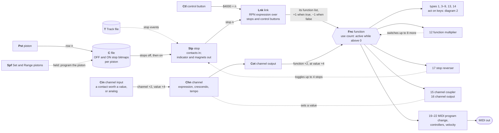
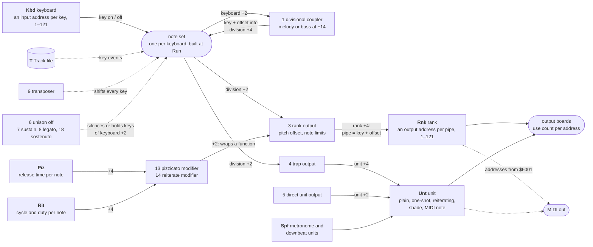

# How the lists of a definition link together

A definition (`D` file) is a set of lists, and the lists refer to each other by
item number (1-based, in list order). This is how they connect when the relay
runs. Field offsets (`+2`, `+4`, ...) are body offsets, as `devdef.py --item`
prints them; the full field tables are in
[`../system-monitor/README.md`](../system-monitor/README.md#definition-files-d).

## 1. What switches a function on

## 2. What an active function does with keys

How to read it:

- **Boxes headed with a list name** (`Kbd`, `Stp`, `Lnk`, ...) are lists in the
  `D` file, and the numbered boxes are the types of `Fnc` item. `T` and `C` are
  the Track and Combination files, which refer to the definition's keys, stops
  and pistons by number. Rounded boxes are what the relay builds or drives at
  run time.
- **A key reaches a pipe in three steps.** A key goes into its keyboard's note
  set. Every active function hooked on that note set sees it. A rank output
  function (type 3) then turns key + pitch offset into one of its rank's pipe
  addresses.
- **Stops do nothing by themselves.** Drawing a stop re-evaluates every link
  whose expression mentions it. When a link turns true, each function in its
  list gets a use count of +1 and is active while the count is above zero, so
  two links can share one function. Channel outputs switch functions the same
  way, by channel value, which is how the crescendo pedal draws stops.
- **Couplers chain.** A divisional coupler takes the keys of the keyboard at
  `+2` and feeds them, offset, into the note set of the division at `+4`, where
  they count like played keys. With "couple the couplers" (`+12`) the coupled
  keys are coupled on again.
- **Modifiers wrap another function.** Pizzicato and reiterate take the
  function at `+2`, usually a rank output, and time its notes from a `Piz` or
  `Rit` table.
- **MIDI is just another address.** Any input or output address from `$6001`
  up is MIDI (a note, or a program change for inputs from `$6801`), so a rank or
  unit given such addresses plays a MIDI instrument instead of magnets.

Not shown: `Ind` (system lamps such as disk busy and recording, driven by the
monitor itself), `Div` (an old division list the loader turns into keyboard
references) and the timing fields of `Spf`.
