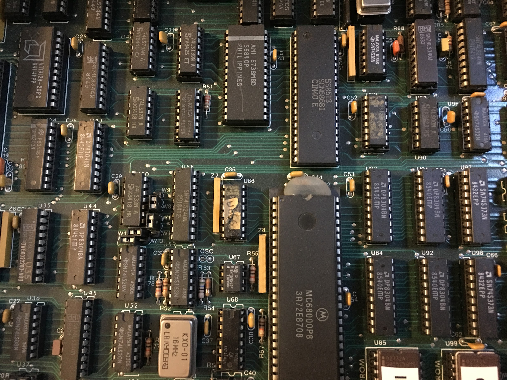
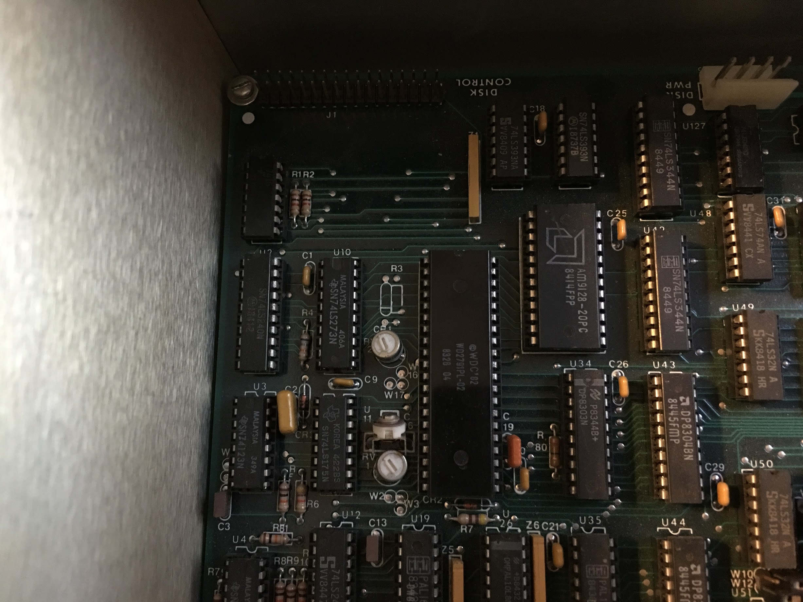
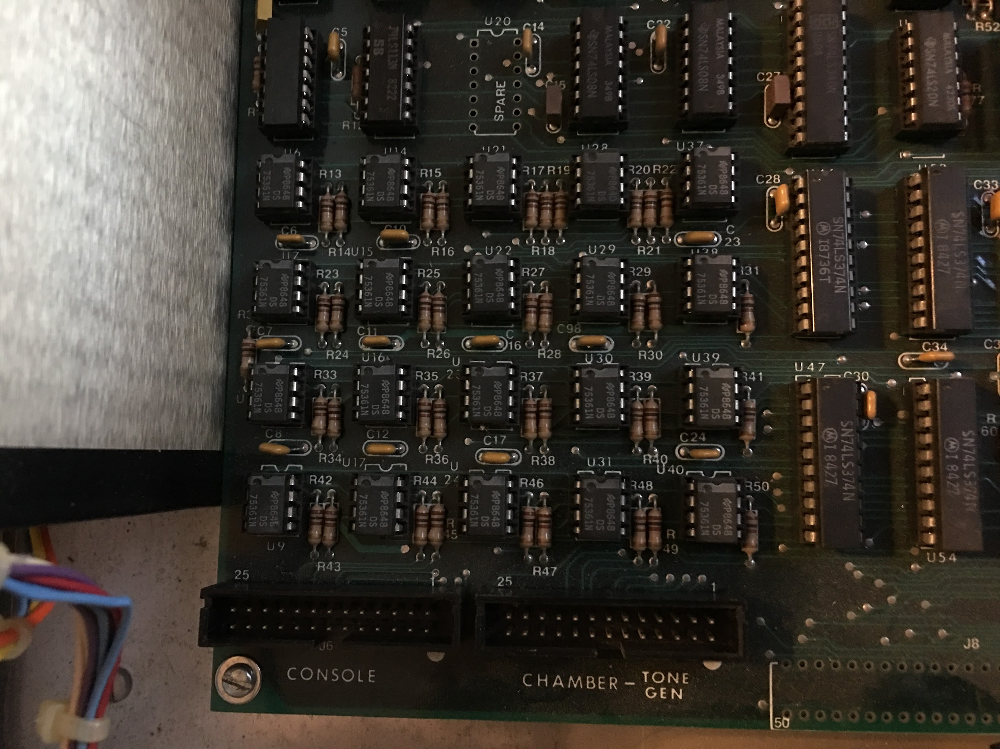
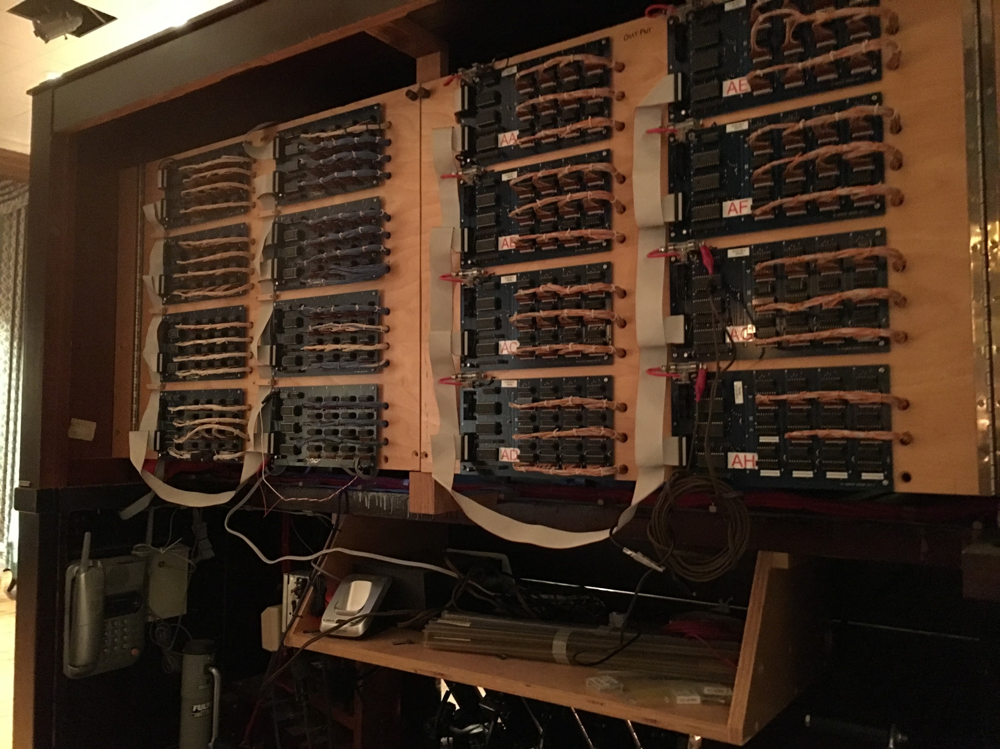
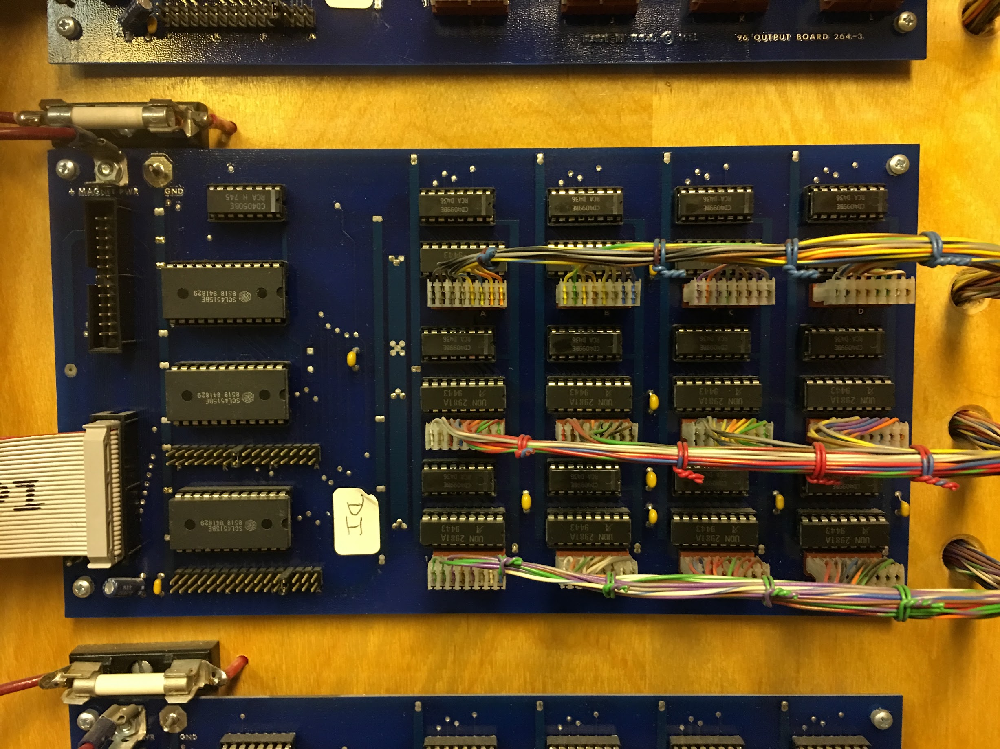
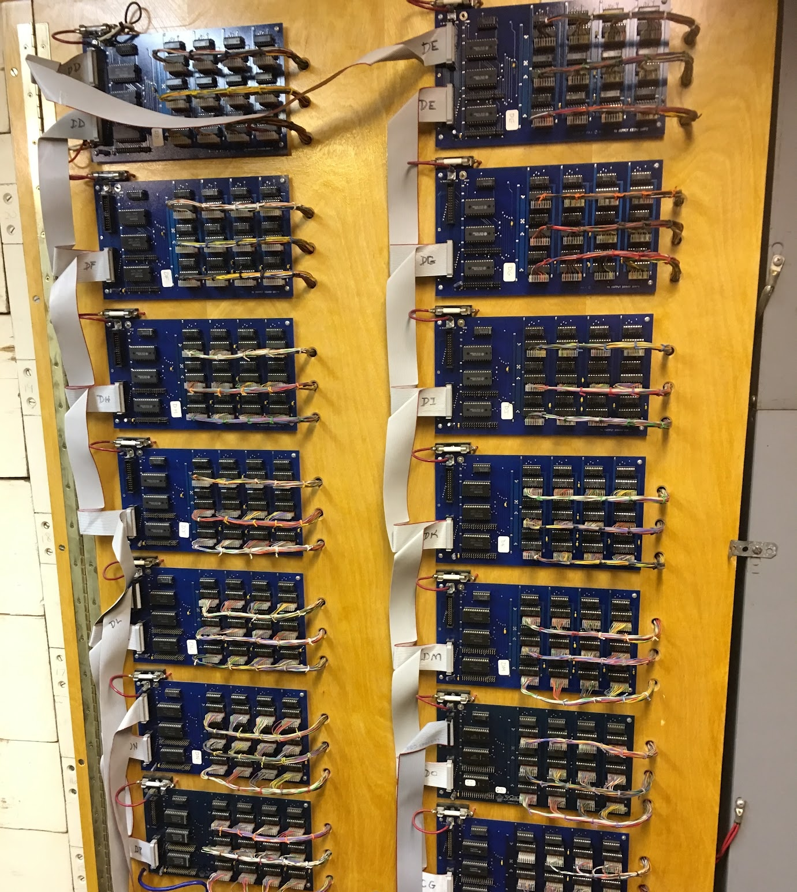
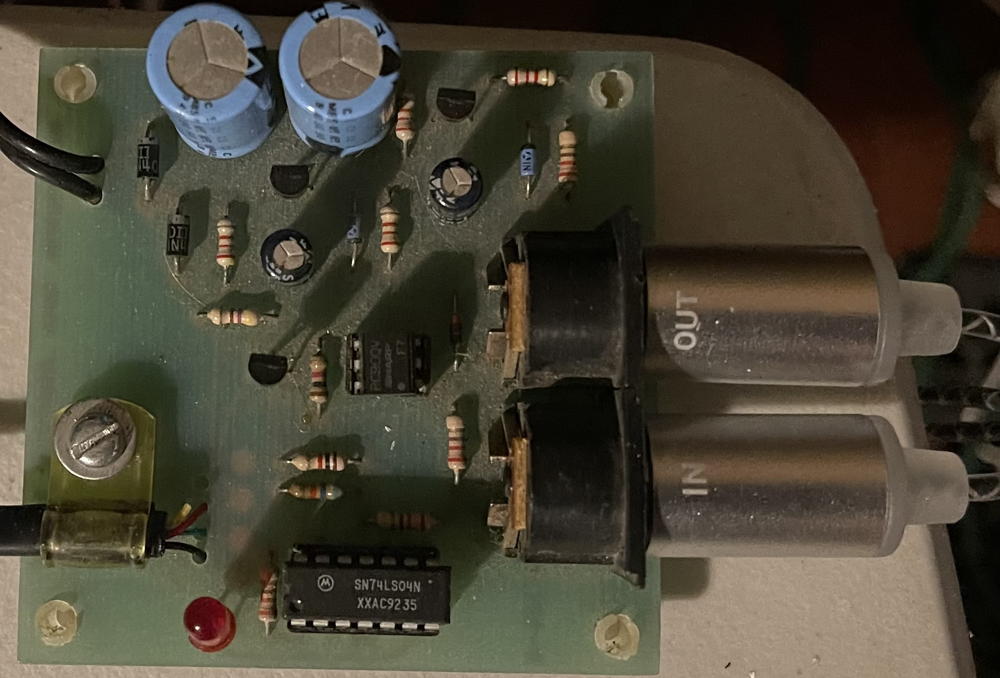
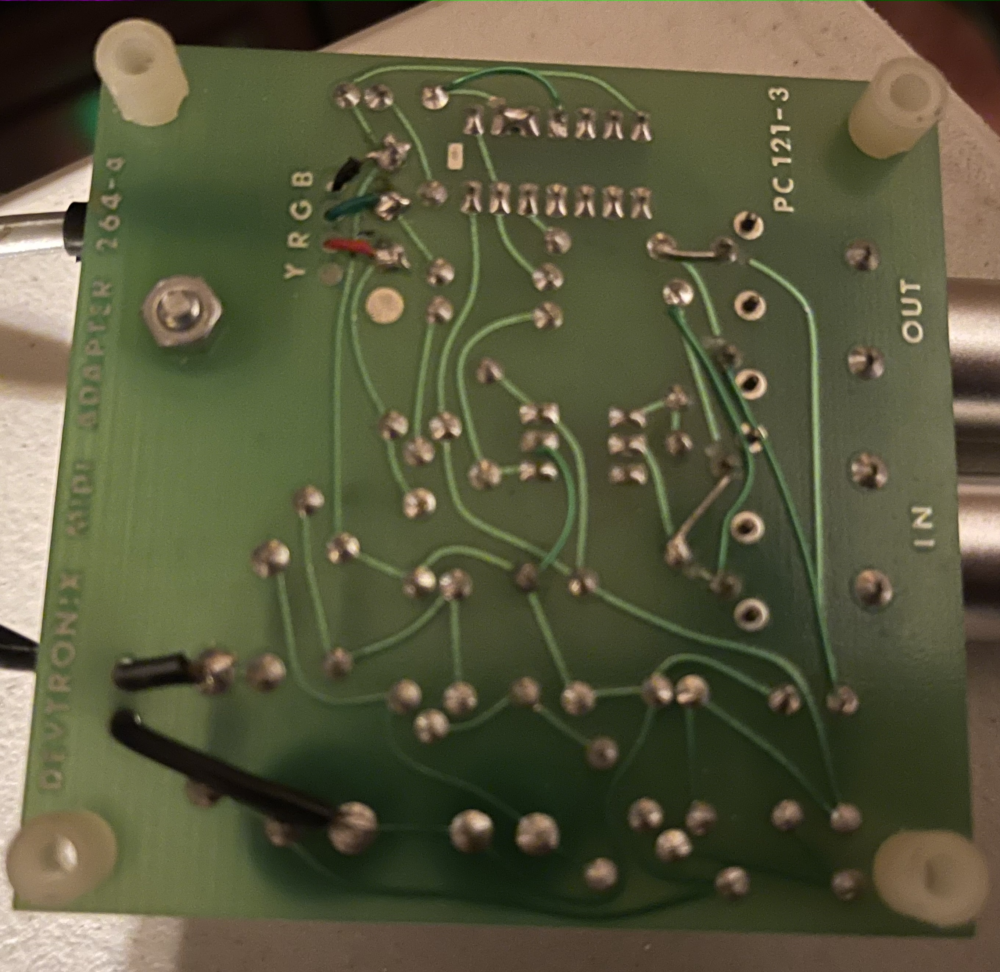

# Devtronix Model 264 — System Monitor 2.6 (183)

Reverse-engineering notes for the operating software of the Devtronix Model 264
pipe-organ relay: the 73 KB "System Monitor" that the boot ROM
(`../boot-rom/`) loads from floppy. This is the program that owns the file
system, the console scanner, the recorder and the player, so it is what defines
the format of the music on the disks in `../disk-images/`.

## Files

| File | What it is |
|---|---|
| `monitor-183.raw` | The file as it is on disk (`A1` of `system-monitor-v189`), 74752 bytes, loads at `$1032` |
| `monitor-183.bin` | Same with the two bytes of every word swapped: a normal big-endian 68000 image |
| `monitor-183.asm` | Annotated disassembly (generated, 22 000 lines). Read the header first |
| `monitor-183.sym` | Names, comments and table hints that `mdisasm.py` merges into the listing |
| `mdisasm.py` | Flow-following disassembler written for this image (knows its calling conventions) |
| `monitor-183-strings.txt` | String table (command names, editor fields, error messages, screens) |
| `devfs.py` | File-system reader: directory listing, extraction, Track/Song event decoder |
| `devcomb.py` | Combination (`C`) file decoder: pistons, ranges, stops drawn |
| `devdef.py` | Organ definition (`D` file) reader: lists keyboards, ranks, stops, links, functions as the editor shows them |
| `dev2midi.py` | Renders a Track/Song file to a standard MIDI file using its definition |
| `render_all.py` | Renders every `T` file on every disk image to MIDI (plain and `--ranks`) and writes `../renders/INDEX.md` |
| `fluxdecode.py` | Decodes the KryoFlux stream dumps and the HxC `.hfe` to sector images in `../decoded-images/` (own MFM decoder, no external tools) |
| `COMMANDS.md` | Reference of every command in every mode (Idle, Edit, Run, RunEdit) |
| `monitor-189.*` | The same for "System Monitor Ver 189" (`A2` of the v189 disk), see the comparison section |

Rebuild the listing with
`uv run mdisasm.py monitor-183.bin --sym monitor-183.sym --speculate -o monitor-183.asm`.
Of the 74752 bytes, 45.8 KB are traced as code; the rest is tables, help text
and screen layouts, which the listing shows as data.

## How the program is built

- **Position independent.** The first instruction is `lea 0(pc),a5`, so A5 is
  the relocation base (0 when loaded at `$1032`). Every global variable is
  `d16(a5)`, i.e. the first 4 KB of RAM, and modules call each other with
  `move.l #addr,d7 ; jsr (a5,d7.l)`. The monitor can also be loaded over the
  PC link at another address ("Executing system file").
- **A small multitasking kernel.** `trap #0` with the function number in D7 is
  the system call (62 functions, table at `$356A`, all named `sys_*` in the
  listing): round-robin scheduler (`sys_yield/sleep/wake`), first-fit heap
  (`sys_malloc/free`), a text-window system (`sys_openwin`, `sys_selwin`,
  `sys_gotoxy`), console and modem I/O rings, a printf, a command-line parser,
  linked-list helpers and a CRC-16. Three calls take a NUL-terminated string
  *inline after the trap* (`sys_putinline` `$0B` always, `sys_printf` `$03` and
  `sys_message` `$35` when D6 bit 0 is set); the handler steps the return
  address past the string.
- **Ten tasks** (table at `$A776`): `SCN` console scanner, `OPR` operator
  (command line and modes), `FIL` disk, `CTL` console-button commands, `PLA`
  player, `REC` recorder, `STS` status display, `SNG` song list, `PCL` PC link,
  `DBG` debug console on DUART channel B (woken only when the boot ROM found
  the terminal on channel B, the `$46` flag).
- **`trap #1`** is the disk/file service (28 functions, table at `$3F48`,
  named `dsk_*`). The caller keeps a *file request block* in A3; the service
  posts the command to the FIL task and sleeps until it is done. Byte 0 of the
  block receives the error code and the trap returns with Z set on success.
- **`trap #3`** schedules a callback on a 1 ms timing wheel (used for magnet
  pulse lengths, the metronome and the player).
- **Modes** (`cmd_table` at `$38B8`: 88 entries of `{mode.w, allowed.w, name[8],
  handler.l, param.w}`): Idle/Menu, Edit (definition editor), Run (organ
  running: Record, Play, Tempo, Meter, Finish, Kill, ...), RunEdit.

### Hardware the monitor touches

| Address | Device |
|---|---|
| `$FFFFFE11..1F` (odd bytes) | MC6840 programmable timer, 800 kHz clock. T1 = 1 ms tick (level-6 interrupt, vector `$78`), T2 = tempo pulse, T3 = one-shot pulse timer |
| `$FFFFFE21..3F` | MC68681 DUART, A = terminal, B = modem/debug, interrupt vector `$3C` |
| `$FFFFFF80 / 82` | Console scanner data and control words: input boards, output (magnet) boards, and a successive-approximation A/D for the analog inputs (swell shoes) |
| `$FFFFFF84 / 86` | Scanner strobes, cleared every tick |
| `$FFFFFFE0..E7` | WD179x floppy, exactly as the boot ROM uses it (`../boot-rom/README.md`) |
| `movec CACR` | "Dimension-030 Turbo Mode": a 68030 accelerator; its driver is the last 340 bytes of the image |



*The parts the monitor drives, on the "Organ Computer Control 264-1" board: MC68000P8
with its 16 MHz oscillator (8 MHz bus clock), the Signetics SCN68681 DUART, the AMI
S6840 programmable timer, AM9128 static RAM, DP8304 bus transceivers and 74LS373
latches. The 3.6864 MHz crystal that clocks the DUART's baud-rate generator is just out
of frame at the top right.*



*The "DISK CONTROL" corner: a Western Digital WD2791 floppy controller (the WD179x
register map the boot ROM and monitor drive), with an AM9128 2 KB static RAM beside it,
74LS273/74LS175 latches, and the two trimmers of the WD2791's data separator.*

The tempo timer is programmed as `latch = 500000 / BPM`, which with the 800 kHz
clock gives **96 pulses per beat**; at the default tempo of 120 that is 192
pulses per second. All recorded timing is in these pulses.

## Terminals

The console is a serial terminal on DUART channel A (9600 baud by default). The
monitor draws its windows with seven terminal-specific sequences, chosen by the
`Term n` command through `term_select` (`$1B56`) from `term_tables` (`$1B8A`):
seven tables of seven pointers, copied to `$9D4(a5)`. The slots are: clear
screen, cursor-address lead-in (followed by row+32, column+32), line-graphics
on, line-graphics off, the box-drawing glyph string (blank, then ┌ ┐ └ ┘ ├ ┤ ┬
┴ ┼ ─ │ in that order), cursor on, cursor off.

| `Term` | Terminal | Clear | Cursor | Graphics on / off | Box glyphs | Cursor on / off |
|---|---|---|---|---|---|---|
| 0 | TeleVideo 950 family (also 925/Wyse in TVI mode) | `ESC = ␠ ␠ ESC Y` | `ESC =` | `ESC $` / `ESC %` | `fgehmlnoikj` | `ESC . 3` / `ESC . 0` |
| 1 | Wyse 50 family, alternate graphics switch | `ESC ; ESC \` 3` | `ESC =` | `ESC H ~` / `ESC H }` | `2315490=8:6` | `ESC \` 1` / `ESC \` 0` |
| 2 | TeleVideo, cursor never hidden | as 0 | `ESC =` | as 0 | as 0 | `ESC . 3` / `ESC . 1` |
| 3 | TeleVideo without line graphics | as 0 | `ESC =` | none | `+++++++++-\|` | `ESC . 3` / `ESC . 0` |
| 4 | Minimal: cursor addressing and clear only (ADM-3A class) | as 0 | `ESC =` | none | `+++++++++-\|` | none |
| 5 | Devtronix PC terminal program (IBM PC, code page 437) | `FS` ($1C) | `GS` ($1D) | none | `┌┐└┘├┤┬┴┼─│` | `US` ($1F) / `RS` ($1E) |
| 6 | **[Wyse WY-50](https://terminals-wiki.org/wiki/index.php/Wyse_WY-50)** | `ESC ; ESC \` 3` | `ESC =` | `ESC H ^B` / `ESC H ^C` | `2315490=8:6` | `ESC \` 1` / `ESC \` 0` |

Type 6 is the WY-50 as its manual describes it: `ESC ;` clears, `ESC \` n`
sets the cursor style, `ESC H ^B`/`ESC H ^C` enter and leave line-drawing mode,
and the digits and punctuation `2 3 1 5 4 9 0 = 8 : 6` are its box characters.
Type 1 is the same terminal with `ESC H ~` and `ESC H }` for the graphics
switch; which Wyse model or firmware wanted that is not known. Type 5 is
selected automatically, whatever `Term` says, when the boot ROM found the
console on channel B (the modem port, `console_b` = `$FF`): a PC running
Devtronix's own terminal program, which also handles the `Topc`/`Frompc`
transfers. `Term` does no range check; `Term 7` happens to land on the type-0
table.

The current type is a word at **offset 6 of the monitor image** (`$1038`).
`System [n]` saves the running monitor to disk with type *n* baked in, so each
disk's monitor records the terminal its owner used. Over the 48 monitor images
in the collection: 45 default to **6, the Wyse WY-50**; Jerry's disc (monitor
2.5) and the New Console disc default to 0, TeleVideo; the Stephen Ross copy
says 7, which behaves as TeleVideo.

## The file system

Everything below was read out of the FIL task (`task_fil`, `$3EEA`) and
checked against the disk images with `devfs.py --check` (the allocation bitmap
agrees with the files on every disk).

### Geometry

As in the boot ROM: 1024-byte sectors, 5 per track, 80 cylinders, 2 sides,
logical sector *n* → track n/5, sector n%5+1; double sided: cylinder =
track/2, side = track&1. The monitor also supports 512-byte sectors (9 per
track, `sector_size = $200`), single-sided disks and three drives, but every
image in the collection is the 1024-byte double-sided format. Byte order: 16-bit
fields are stored low byte first, strings in byte order.

### Boot block (logical sector 0)

| Offset | Field |
|---|---|
| `$00` | flags: bit 0 = double sided |
| `$01` | `$F2` = system disk signature ("Disk format error" otherwise) |
| `$02` | word: total sectors (800) |
| `$1C` | volume label, NUL terminated, up to 26 chars (`Dskname` command) |
| `$36` | word: header sector of the file to boot, 0 = none (`Boot` command) |
| `$38` | word: its load address (`$1032`) |
| `$6C` | **directory**: 4-byte entries `{slot number, slot letter, header sector (word)}`, kept sorted by letter then number, terminated by `$FF FF FF FF`. Room for 101 entries |
| `$200` | **allocation bitmap**: bit *n-1* of this 100-byte area set = logical sector *n* in use (sector 0 is implicit). Allocation takes the first clear bit; "Disk is full" when none |

The monitor keeps a copy of the boot block in RAM (`boot_block`, A5+`$256`) and
writes it back at unmount when the directory changed. "Free disk:" on the status
screen is the number of clear bitmap bits.

### Slots and file types

A file is addressed by its **slot**: a letter and a number 1–99, e.g. `A4`,
`T12`. The letter is the file type; commands check it and raise "File type
mismatch" if it is wrong:

| Letter | Type | Used by |
|---|---|---|
| `A` | system monitor image | `Boot`, `System` (save the monitor), the boot ROM |
| `D` | organ definition | `Load`/`Save` in Idle mode, autoloaded as `D1` |
| `C` | combination (piston) settings, see "Combination files" | `Load`/`Save` in Run mode, autoloaded as `C1`, `C99` autosave |
| `T` | track / song recording | `Record`, `Play`, `Analyze`, `Process`, `Split` |

`Split` writes the songs it cuts from a track back as `T` files too (named
`"<slot> (Song n meas m)"`), so Track and Song files share one format. The
console's two-digit "File #" display and the File Up/Down pistons select the
slot number for Record/Play.

### File header sector

Each file owns one sector that holds its header; the directory points at it.

| Offset | Field |
|---|---|
| `$00` | word, always 0 in the images (not used by the monitor as far as traced) |
| `$02` | word: **bytes used in the last sector** (`$02AA` = 682 for the monitor: 72 full sectors + 682 = 74410 bytes) |
| `$04` | file name, up to 25 characters, NUL terminated. Byte `$1D` must be 0 or `Dir` prints "Header record contains trash" |
| `$40` | **extent list**: pairs of words `(first sector, count)`, ended by a first sector of 0. Files are allocated sector by sector and runs are merged, so most files have one extent |

File size = (sectors − 1) × 1024 + header[`$02`]. Reading is sequential: the
monitor maps block *n* through the extent list ("Illegal disk record number" if
*n* is past the end), reads it into a 1 KB buffer and hands out bytes
(`dsk_getbyte`). The first 4 bytes of a sector buffer in RAM are a link to the
next buffer; on disk the sectors are plain data.

The error strings at `$86DC`, in order, are the error codes a request block can
return: 1 Invalid file name, 2 Disk not ready, 3 Disk read error, 4 Disk file
not found, 5 Duplicate file name, 6 Disk is full, 7 Disk is write protected, 8
End of disk directory, 9 Illegal disk record number, 10 Disk format error, 11
Disk header record error, 12 File type mismatch, 13 File operation cancelled,
14 Remote disk file not found.

### File request block (A3 in every `trap #1`)

Allocated with `sys_malloc` of `$83A` bytes by each command that touches a file.

| Offset | Field |
|---|---|
| `$00` | error code (0 = ok) |
| `$02` | drive: 0–2 floppy, 3 = PC disk over the serial link |
| `$04` | FIL command: 1 mount, 2 unmount, 3 read sector, 4 write sector, 7 create, 8 write header, 9 delete, 10 read block, 11 flush block and allocate next, 12 read header |
| `$0C` | sector number; `$0E` buffer address; `$12` byte offset in the buffer |
| `$14` | file name from the command line (25 + NUL) |
| `$2E` | slot number; `$2F` slot letter; `$30` header sector |
| `$32` | the 1 KB header sector image (`$34` = bytes in last sector, `$36` = name, `$72` = extents) |
| `$432` | current block index; `$834` total sectors; `$836` size in bytes |

## Track / Song files

A recording is a byte stream of events separated by time deltas, written by the
REC task 1 KB at a time (`rec_begin_event`, `$D048`) and interpreted by the PLA
task (`play_event`, `$D512`). The `Analyze`, `Process` and `Split` commands walk
the same stream with the class table at `$D93A` (indexed by event byte − `$80`;
read it in disk byte order, the listing shows words swapped).

**Timing.** A byte `$00..$7F` adds that many pulses to the current time;
`$FC hi lo` adds a 16-bit delta and `$FD b3 b2 b1 b0` a 32-bit one. A pulse is
1/96 beat of the tempo clock, 1/192 s at the default tempo of 120. Nothing in
the file records the tempo; `Split` and the "Time:" displays also assume 192
pulses per second. The recorder's pulse counter starts when the organ is
running and `Go`/Record starts, so the first delta is the lead-in.

**Events** (first byte ≥ `$80`):

| Byte(s) | Meaning |
|---|---|
| `$80+k key` / `$A0+k key` | key *key* on keyboard *k*+1 released / pressed (bit 5 = on, low 4 bits = keyboard 0–15) |
| `$C0..$CF` | console change (recorded for information, ignored on playback) |
| `$D0+c v` | analog channel *c*+1 (swell shoe, crescendo) set to *v* (0–255) |
| `$E0..$EF` | unused |
| `$F0 hi lo` / `$F1 hi lo` | stop number *hi·256+lo* off / on (1-based stop numbers from the definition) |
| `$F7 s d1 [d2]` | MIDI message *s d1 d2*, length from the status byte |
| `$F8 ... $F9` | **sync block**: sub-records until a 0 byte: `05 n(hi lo) bitmap` = the *n* stop states (bit *i*, LSB first, = stop *i*+1 on); `06 n v1..vn` = the analog channel values. A recording starts with one; `Split` writes one at the head of every song (`$01` is accepted as an alias of `$05`) |
| `$FA` | ignored |
| `$FB len ...` | check record; skipped by the player, `Analyze` reads a key count from it |
| `$FE` | end of this 1 KB block: the rest of the block is padding (zeros), continue with the next block |
| `$FF` | end of track |

Everything else in the organ (which key number is which pipe, what a stop
number means, which keyboard is which manual) comes from the `D` definition
file that was loaded when the track was recorded, so a track needs its
definition to be rendered; the definition format is in the next section. The
combination (`C`) file format is not decoded.

`devfs.py --events SLOT` prints a track as a list of timed events;
`decode_events()` in the same file is the reference implementation. On every
`T` file of `58-note-01` and `jerrystourdisk` the stream ends on the `$FF` at
the recorded file size and key-on and key-off counts balance exactly, except
for `T32` of `58-note-01` (the disk is full, the file is cut short) and `T6`
"Sleigh Ride" on Jerry's disk, which has garbage in logical sectors 308–310 (blocks 19–21 of the file,
probably a bad read in the image).

## Definition files (D)

Read out of the `Load` code (`sub_057C6`, `$57C6`), the `Save` code
(`sub_05726`, `$5726`), the list table at `$182C`, the run-time set-up that
turns the lists into scanner and relay tables (`$9758`–`$A1E2`) and the
definition editor's field descriptors (hash table `edit_hash_table`, `$F3C4`,
one 12-byte entry per screen field: flags, kind, row/column, label, referenced
list, body offset). Checked against the `D` files of `jerrystourdisk`,
`58-note-01`, `newconsole`, `mccoy3-mccoyconsole` and `pcc-backup-1-95`
(`devdef.py` consumes each file exactly to its end).

### Container

```
word   version: $1A12..$1A15 accepted ("Definition file not current format"
       otherwise); the monitor writes $1A15
repeat
    word  list id (see table), word item count
    per item:  byte len, len bytes of record body (trailing zeros trimmed)
               byte len, len bytes of item name (no terminator)
word   $FFFF
```

All 16-bit fields are little-endian. Versions before `$1A15` use a word for the
two lengths and have 8 obsolete bytes at the head of every body. In RAM each
item is a kernel list node `{next.l, name.l, body}` of the node size below; the
loader pads the body with zeros, so a short body just means trailing zero fields.
Items are numbered from 1 in list order; every reference between lists (and
every stop number in a Track file) is such an index. Lists are stored in the
order of `dat_05ABE`: Kbd Rnk Unt Stp Lnk Fnc Pst Chn Cin Cot Piz Rit Spf Ctl Ind.

| List | Id | Node | Body | What the body holds |
|---|---|---|---|---|
| `Kbd` keyboard | `$4514` | 254 | 246 | 123 words: word *k* = console input address of key *k* (1–121; word 0 and 122 unused) |
| `Rnk` rank | `$72BB` | 252 | 244 | 122 words: word *n* = output address of pipe *n* (1–121); word 0 unknown, 0 in every file |
| `Unt` unit | `$8584` | 28 | 20 | +0 type (1 normal output, 2 timed, 3 reiterate, 4 analog, 5 MIDI note), +2 location, +4 output address, type-specific fields after |
| `Stp` stop | `$79F0` | 30 | 22 | +0 hardware type (1 button/switch, 2 dual-magnet stop, 3 reversible, 4 dual-contact drawknob), +6 indicator address, +8 contact address (+10 OFF contact for type 4), +12/+14 ON/OFF magnet addresses, +16 debounce ms, +18 combination status byte, +20 record/play status byte (nonzero = not recorded/played). +2 and +4 are not in the editor (+4 is often `$00FF`) |
| `Lnk` link | `$4D3B` | 58 | 50 | +0: up to 15 words of RPN expression, 0-terminated: *n* = stop *n* on, `$4000+n` = control button *n*, `$8000` or, `$8001` not, `$8002` and (`stop_event` → `$AE34`). +30: up to 10 function numbers |
| `Fnc` function | `$27B3` | 26 | 18 | +0 type, then per type (see below) |
| `Ctl` control button | `$15EC` | 14 | 6 | +0 type (keypad digit, record/play start, ...), +2 input address, +4 debounce |
| `Ind` indicator | `$3A74` | 12 | 4 | +0 type (disk busy, record active, ...), +2 output address |
| `Pst` piston | `$670C` | 12 | 4 | +0 input address, +2 debounce |
| `Piz` / `Rit` | `$6582` / `$71FC` | 252 | 244 | timing tables, one word per note: `Piz` word *n* = how long note *n* sounds, in ms (Jerry's: 50 ms, 30 ms in the treble, 80 ms for the pedal); `Rit` word 0 = "random timing" flag (`$FF`), word *n* = reiterate cycle for note *n*: low byte = cycle time in ms, high byte = duty in tenths (Jerry's glockenspiel `$0550` = 80 ms cycle, on for 40 ms). See "The relay", modifiers |
| `Chn` channel | `$140E` | 12 | 4 | +0 type (1 expression, 2 crescendo, 3 tempo control), +2 record flag |
| `Cin` channel input | `$1436` | 18 | 10 | +0 contact address, +2 channel, +4 value 0–255, +6 debounce, +8 sensitivity |
| `Cot` channel output | `$152C` | 14 | 6 | +0 channel, +2 function, +4 value at which it fires |
| `Spf` special functions | `$7946` | 68 | 60 | one item: set/range piston, tempo button and control, play/record switch addresses, metronome/downbeat units, magnet pulse time, console polarity, sensitivity, scan timing |
| `Div` | `$28A7` (`$6480`) | 10 | 2 | old division list; the loader turns the references into keyboards |

The exact field list per list and type, with offsets, is the `FIELDS` table in
`devdef.py` (generated from the descriptors; `TYPE_NAMES` has the type names).

**Function types** (`Fnc` +0): 1 divisional coupler (+2 keyboard played, +4
division whose stops sound, +6 pitch offset, +8/+10 note limits, +12 couple
the couplers, +14 melody special function), 2 rank coupler (obsolete), **3
normal rank output** (+2 division/keyboard, +4 rank, +6 signed pitch offset in
semitones, +8 bottom and +10 top note limit, 0 = 1/121), 4 trap output (+2
keyboard, +4 unit), 5 direct unit output (+2 unit), 6 division unison off (+2
keyboard), 7 sustain, 8 legato, 9 transposer (+2 type, +4 change), 12 function
multiplier (+2.. eight functions), 13 pizzicato modifier and 14 reiterate
modifier (+2 modified function, +4 timing table), 15 channel coupler, 16
channel output, 17 stop reverser (+2.. four stops), 18 sostenuto, 19–22 MIDI
program change / controllers / velocity (+2 MIDI channel, +4 number). Type 0 =
unused item. The relay builds a function block per function at start-up
(`sub_09D3A`, jump table `$9D98`), and at run time a stop change re-evaluates
the links that mention the stop and activates or releases their functions
(`spec_0ADFE` → `sub_0AE86` → `sub_0AED4`, with a use count per function).

**Spare fields.** `Stp` body words +2 and +4, `Rnk` word 0 and `Kbd` word 122 are
not among the editor's fields and are never read by the relay or the file code:
`Rnk` and `Kbd` bodies are simply 122/123-word arrays indexed by note number
(note 0 does not exist), and the two `Stp` words are left over from an earlier
record layout (versions before `$1A15` carried 8 obsolete bytes at the head of
every body). Nothing in them matters for playback.

**Notes.** Keys and pipes share one absolute 121-note scale: note 1 is the C of
the 32' octave (MIDI 12), **note 25 is 8' C, the bottom key of a 61-note manual
and of the pedal** (MIDI 36), 85 is the top C of a manual. The key byte of a
Track event is this number (the scanner table index, `sub_097A4`), already
transposed if the transposer was on. A stop sounds rank pipe *key + pitch
offset* (−12 for a 16' stop, +12 for 4', +19 for 2⅔', `tbl_09D98_3`), and only
if that pipe has an address. A keyboard's compass is simply the keys that have
addresses: all five organs have manuals at 25–85 and pedals at 25–56.

**Console I/O addresses** (`sys_putaddr`, `$5DB6`): 0 = none (`-----`),
otherwise *v−1* = `board1<<11 | board2<<7 | pin<<3 | digit` printed as
`AA-A1`..`PP-P8`. Values ≥ `$6001` are MIDI outputs: channel = bits 7–10,
note = low 7 bits − 1 (`$6025` = channel 1 note 36).

**Names.** Only some stops carry a name; the editor's "computer generated" stop
names come from the link and function named like the stop (Jerry's definition
names 38 of 710 stops but every function), so `dev2midi.py` falls back to the
first named link or function of the stop.

### devdef.py and dev2midi.py

```
uv run devdef.py SIDE0 SIDE1 -d D1                 # keyboards, channels, named stops
uv run devdef.py SIDE0 SIDE1 -d D1 --list Fnc      # one list (Kbd Rnk Unt Stp Lnk Fnc ... or all)
uv run devdef.py SIDE0 SIDE1 -d D1 --item Stp 2    # every field of one item, like /STP2 in the editor
uv run devdef.py --file def.bin --list Kbd         # from bytes extracted with devfs.py
uv run dev2midi.py SIDE0 SIDE1 -t T8 -d D1 -o danny-boy.mid           # one MIDI channel per keyboard
uv run dev2midi.py SIDE0 SIDE1 -t T8 -d D1 --ranks -o danny-boy-ranks.mid   # through stops and ranks
```

`dev2midi.py` writes a format-1 file with 96 ticks per beat (one tick per
pulse) at 120 BPM unless `--tempo` says otherwise. In `--ranks` mode it also
models what the relay does beyond pipes: **traps** (units with drum-like names,
struck when a type-4 trap function sees a key on its division or a type-5
function switches the unit on; reiterating units repeat at their cycle time) go
to a "Traps" track on General MIDI channel 10; **tremulants** (units named
"...Trem...", matched to the ranks of their chamber and to ranks named in the
tremulant's name) become modulation (CC1) on the affected rank tracks;
**expression** follows the chamber's shade units (named "...Shade n" or
"...upper/lower/side n", whether switched by stops as on Jerry's organ or by
channel-value outputs as on the PCC) as CC11, with the chamber of each rank
taken from its name or its output boards; **melody and bass couplers** pass
only the highest or lowest key; **pizzicato** notes are released after the
table's time, and **reiterating** notes retrigger at their cycle and duty,
stepping through the function's pitch offsets. Track 0 carries the tempo
and a marker for every stop change (and the initial sync block) plus text
events for the swell-shoe channel values. In the default mode each keyboard
gets a track and a channel (Church Organ) and every key plays at its own pitch,
so the pedal sounds at 8'. With `--ranks` the file is played through the
definition the way the relay does it: stops → link expressions → rank-output
functions → pipes, with divisional couplers and unison-off honoured, one track
per rank (General MIDI programs picked from the rank name: organ, piano, harp,
chimes, ...). Not rendered: traps and units (drums, effects), tremulants,
expression, pizzicato/reiterate timing and control-button terms in link
expressions (taken as off). Renders of "Danny Boy" and "Joy To The World" from
Jerry's disk and `T1` of `58-note-01` are in `../renders/`; the opening of Joy
To The World is the descending D-major scale and Danny Boy starts B C D | E D E
A G E D E D C A on the Great, so the key numbering and the 120 BPM clock are
right (Danny Boy comes out at 4:29).

## Combination files (C)

Read out of `save_c_file` (`$559C`), `load_c_file` (`$5528`), the table set-up
in `sub_0A0BC` (`$A0BC`) and the piston handler `sub_0B68A` (`$B68A`); checked
against all 27 real `C` files in the collection (`devcomb.py` parses each one
exactly to its end).

```
word  pistons   number of Pst items in the definition when the file was saved
word  stops     number of Stp items
word  hb        (stops + 8) // 8 = bytes per bitmap
pistons x (hb bytes OFF bitmap, hb bytes ON bitmap)
```

All words little-endian. Row *i* belongs to piston `Pst i` (its console input
address is in the definition). In each bitmap, stop *n* is bit `(n-1) & 7` of
byte `(n-1) >> 3`, the same convention as a Track sync block. In RAM the table
is the same bytes at `$8a2(a5)` (`$8a8` = pistons, `$8aa` = hb,
`num_stops` = stops), so `Load C` is a plain copy and `Save C` writes it back.

What the two bitmaps mean (`sub_0B68A`):

- **Piston pressed:** every stop in the OFF bitmap gets a stop-off event, then
  every stop in the ON bitmap a stop-on event (`sub_0B6D6`). Stops in neither
  are left alone, so OFF ∪ ON is the piston's *range*, the stops it captures.
- **Set + piston** (`$8a6`, the Spf "Set piston" held): ON is merged into OFF
  (the range is kept), then every stop currently drawn that is in the range
  moves from OFF to ON (`sub_0B742`). Beep.
- **Set + Range + piston** (`$8a7`): the drawn stops become the range: a drawn
  stop not already ON is added to OFF, an undrawn stop is removed from both
  (`sub_0B704`). So "Range" programs *which* stops a piston controls without
  changing their states.
- **Range + piston** (no Set): shows the range on the tabs: every stop in the
  range is turned on and every other stop off (`sub_0B78C`).

So an unprogrammed piston has both bitmaps empty, a General Cancel has every
stop in OFF and none in ON, a divisional's range is one division's stops, and
a general's range is most of the organ. The file does not record piston
names (the `Pst` items are unnamed in every definition here); `devcomb.py`
labels each piston by the divisions its range covers.

The file is tied to the definition it was saved with: the loader does not
check the stop count, so a `C` file saved under an older definition (New
Console `C1` has 407 stops, its `D1` 417; McCoy3 `C1`/`C2`/`C99` have 81, the
81-stop `D4`/`D23` fit, `D1` does not) renumbers stops when loaded under a newer
one. `C99` is the autosave slot. McCoy3 `C3` is not a combination file at all:
its sectors hold a definition fragment (stop names), i.e. a stale directory
entry over reused sectors.

```
uv run devcomb.py SIDE0 SIDE1 -c C1 [-d D1]      # one line per piston
uv run devcomb.py SIDE0 SIDE1 -c C1 --piston 2   # the stops one piston draws
uv run devcomb.py SIDE0 SIDE1 -c C1 --all        # every piston's ON stops
uv run devcomb.py --file c.bin --def-file d.bin
```

## The relay: scanner, keys, stops and outputs

This is the part of the monitor that makes the organ play: the SCN task
(`task_scn`, `$A7FA`), the run-time tables it builds from the definition at
`Run` time (`relay_build_scan`, `$9758`, and the `build_*` routines before
it), and the event chain from a console contact to a magnet. Everything below
is named in `monitor-183.sym`, so the listing can be read alongside.

### Console scanner hardware (`$FFFFFF80`–`$FFFFFF86`)

Two 16-bit ports, data at `$FF80` and control at `$FF82`, drive the console
and chamber I/O boards (the `AA`..`PP` boards and `A1`..`P8` pins of the
definition). Every operation is "write a control word, write an address word,
read a word back":

| Control word | Operation | Data word written | Result |
|---|---|---|---|
| `$1160` or `$21E6` (`scan_control`, from Spf "Console polarity") | scan an input | address − 1, with the last known state in bit 15 | read back: bit 15 = contact open |
| `$31xx` | analog read, successive approximation | input address | bit 15 = comparator (DAC value `xx` ≥ input) |
| `$3C00` | console (B-series) output | `~(address − 1)`, bit 15 clear = on, set = off | — |
| `$3300` | chamber (C/D-series) output | same | — |
| `$1100` | idle / reset the bus | 0 | — |
| `$11FB` `$2103` `$15FE` `$0300` `$0F00` | the `Tstadr`/`Tstinp`/`Tstotp` board tests | | |

Addresses are the definition's encoding (`board1<<11 | board2<<7 | pin<<3 |
digit`, 1-based). `$FF84` and `$FF86` are cleared by the 1 ms tick while
`pulse_hold` counts down: a watchdog or strobe for the output latches, armed
for 1 s whenever a scan entry is created. A scan of one input costs
`scan_timing` settle loops (Spf "scan timing"); the swell shoes are read by
eight comparisons of a DAC value against the input (`analog_sample`, `$B57E`,
also `read_analog` for the tempo control), with interrupts off around each read.



*Where the scanner leaves the board: the two 26-way headers marked "CONSOLE" (J6) and
"CHAMBER – TONE GEN", fed by rows of DS75361 dual TTL-to-MOS drivers and 74LS374
latches, which is the hardware behind the `$FF80`/`$FF82` ports.*



*Input boards inside the console (labelled AA, AE, AF, AG, AH ...), each with its
daisy-chained ribbon from the scanner and the key, stop and piston wiring on
displacement connectors. These are the "A-series" boards of the definition's addresses.*



*One chamber output board ("'96 OUTPUT BOARD 264-3"): CD4051 address decoders at the
left, ULN2981 driver arrays feeding the pipe magnets at the right, with "MAG PWR" and
"GND" studs for the high-current supply. Each board is 128 outputs, `A1`..`P8`.*



*The chamber boards DD to DP on their wall, each a 128-output "D-series" address in the
definition.*

MIDI uses DUART channel B: received messages are queued by the interrupt
handler as 4-byte records (`midi_rx_ring`) and turned into input events with
the pseudo address `$6001 + channel×128 + note` (`midi_dispatch`, `$A8A8`),
so a MIDI note is just another console input; outputs with an address ≥
`$6001` are sent as note on/off on channel B (`output_midi`, `$B4C2`).




*The "Devtronix MIDI Adapter 264-4" (board PC121-3) that hangs on the rear "MIDI
AUXILIARY" port: a Sharp PC900 opto-isolator on the IN side, an SN74LS04 driving the OUT
side, and the two 5-pin DIN sockets. It turns DUART channel B's serial lines into a MIDI
current loop.*

### The scan loop

`relay_build_scan` walks the definition once and makes two parallel arrays:
`scan_table`, one word per console input (the address with the current state
in bit 15), and `scan_handlers`, a **hook list** per input. Keys (every key of
every keyboard with an address), pistons, channel inputs, stop contacts (both
contacts of a dual-contact drawknob), control buttons and the Spf inputs (Set,
Range, tempo button, play/record switch, metronome) all land here. Inputs with
a debounce time get a timer node in front of their hook. The SCN task then
loops for ever: one pass over the table (`scan_pass`), every pending MIDI
event, one analog input, yield. `scan_rate` counts passes per second and
`worst_delay` the longest gap, both shown on the Run screen.


*The Run screen on the Wyse, with "--- Scanner Initialized ---": disk MCCOY NC 1,
file 05, scan rate 765 passes per second, worst delay 6 ms, free disk and RAM, tempo
120 and meter 4/4, and the Run-mode command list below. On the right, the open 264 with
the HxC floppy emulator; on the left, this project's disassembly on an iPad.*

A **hook list** is the relay's universal mechanism: a chain of
`{next.l, handler.l, args...}` nodes called by `call_hooks` (`$BF3E`) with
A0 at the args and D4 = +1 (on) or −1 (off). Scan entries, keyboards, note
sets, stops and units all own one, and activating a function means linking a
node into somebody's list (`hook_link`, `$C7F0`).

### Keys: from contact to pipe

1. `key_event` (`$AB1C`): keyboard d2, key d3 (1–121, note 25 = 8' C). The
   **key-state byte** of that key (`kbd_states`) gets bit 0 set or cleared;
   couplers that feed this keyboard use the other bits, so a note stays on
   while any source holds it. On 0↔nonzero the key goes to the keyboard's
   **note set** (`key_to_division`), after `transpose` is added, after
   `rec_key` if recording, and after `key_delay` ticks if the Spf "panel
   up/down speed" is set.
2. A **note set** (`build_divisions`, one per keyboard, more for ranks) is
   `{use count per note, hook list, low, high}`. `note_set_change` (`$AD2C`)
   bumps the note's count and calls the hooks only on 0↔1.
3. The hooks are the active functions. A **rank output** function (type 3)
   hangs `rank_out_hook` (`$B440`) on its division's set: note − offset, within
   the function's note limits, indexes the rank's 121 output addresses and the
   pipe's address goes to `output_chamber`. A **divisional coupler** (type 1)
   hangs `note_offset_hook` (`$AD12`): note + pitch offset, within limits, into
   the *target* keyboard's note set, so couplers chain naturally and a coupled
   note counts like a played one. The "melody"/"bass" special couplers use
   `spec_0B7D6`..`spec_0B906` instead, which track the highest or lowest held
   note. Traps and units (type 4, 5) hang `unit_use` (`$B192`), which drives the
   unit by its type: plain output, timed one-shot (timer wheel), reiterating
   (timer with the Piz/Rit tables), analog threshold, or MIDI note.
4. `output_chamber` / `output_console` (`$B48C` / `$B450`) keep a **use count
   per output address**, so a pipe shared by several stops or couplers turns
   on once and off when the last user releases it, and write the board on the
   0↔1 transitions.

The whole chain runs inside the SCN task with interrupts off only around the
bus accesses; the "Key time was %t microseconds" message, when enabled, is the
PTM T3 measurement of one key event end to end.

### Stops: links and functions

`stop_event` (`$B5F4`) dispatches on the stop's **hardware type**: a
dual-magnet stop (type 2) pulses its ON or OFF magnet for `magnet_pulse` ms
(Spf, default 80) through a timer node and does nothing else, since the moving
tab's contact will report the new state; types 1, 3 (reversible: each press
toggles) and 4 (dual contact: each contact sets a state) go through
`stop_contact_change` (`$AD6C`): store `stop_state`, record, drive the
indicator output, then `stop_eval_links`.

`stop_eval_links` (`$ADFE`) re-evaluates every **link** that mentions the stop
(`link_eval` runs the link's RPN expression over `stop_state`, with `$4000+n`
reading control button *n*). When a link's truth value changes, each of its up
to 8 **functions** gets `function_use` ±1 (`$AED4`); a function with a use
count going 0→1 is activated and 1→0 released (`fn_activate`, by type). For
couplers and rank outputs activation is `coupler_activate` (`$C716`): link the
hook into the source note set and replay every note already held there, so
drawing a stop while keys are down sounds immediately. Function types: 1
divisional coupler, 3 rank output, 4 trap, 5 direct unit, 6 unison off, 7/8/18
sustain/legato/sostenuto, 9 transposer (re-plays all keys), 12 multiplier
(activates 8 more functions), 13/14 pizzicato/reiterate modifiers, 15/16
channel coupler/output, 17 stop reverser (toggles 4 stops), 19–22 MIDI program
change, controllers and velocity. A link whose only term is its own stop skips
the evaluator (`link_direct_stops`).

Pistons are handled by `piston_press` (`$B68A`) as described under
"Combination files"; every stop it changes goes through `stop_event` like a
hand-drawn one.

### Couplers with a mind of their own

A divisional coupler's "special function" field (`Fnc` type 1, +14) picks the
hook handler the coupler hangs on its source note set (`fn_block_by_type`,
`$9FA8`):

| Value | Handler | Behaviour |
|---|---|---|
| 0 | `note_offset_hook` | plain coupler: every note, offset, within limits |
| 1 | `melody_hook` (`$B7D6`) | **melody coupler**: only the highest held key sounds on the target; when it is released the next highest takes over |
| 2 | `melody_hold_hook` (`$B7EE`) | melody coupler that does not fall back: the sounding note stays until it is released itself or a higher key is pressed |
| 3 | `bass_hook` (`$B814`) | **bass coupler**: the lowest held key only, falling back upward |
| 4 | `bass_hold_hook` (`$B830`) | bass coupler without fall-back |
| 5, 6 | `single_hook` (`$B906`) | plain coupler with a re-entrancy guard |

Each keeps its current note in the coupler block (`+$1E`); `held_highest` /
`held_lowest` (`$B85A`/`$B872`) scan the source set's note counts.

**Sustain, legato and sostenuto** (function types 7, 8, 18) are not hooks on a
note set but bits in the keyboard's key-state bytes (`kbd_states`): sustain
owns bit 1, sostenuto bit 2, legato bit 4. Activating the function
(`coupler_keys`, `$AC7E`) sets its bit on every key held at that moment, so
those keys keep sounding after release until the function goes off, which
clears the bits and releases whatever only they were holding. While sustain or
legato is on, every new key also gets the bit (`hold_hook`, `$ACC6`); legato
additionally releases every key that only the legato bit was holding, so the
division plays one note at a time. Sostenuto captures only the keys down when
it was switched on.

### Units: traps, tremulants, shades

A unit is one or more console or chamber outputs with a behaviour
(`unit_type_table`, `$B1C8`, driven by `unit_use` on 0↔1 of a use count):

| Type | Body | Behaviour |
|---|---|---|
| 1 | +2 location, +4 address | plain output: on while in use (tremulants, shade stages, lights, most trap actions) |
| 2 | +6 minimum on time, +8 maximum on time, +10 trigger on key-up | one-shot: the output goes on and a timer turns it off after the maximum time; it stays on at least the minimum time; optionally fires on release instead |
| 3 | +4 and +10 two outputs, +6 cycle time ms, +8 duty 1–9 | reiterating: on for cycle × duty / 10 ms, off for the rest, repeated while in use (snare rolls); with a second address the two alternate |
| 4 | +4 .. +18 eight weighted outputs | a channel value as an 8-bit binary pattern on eight outputs (motorised shades) |
| 5 | +2 MIDI channel, +4 note, +6 velocity | MIDI note on/off on DUART channel B |

A **trap** function (type 4: division + unit) hooks `unit_use` on the division's
note set, so the trap fires when the first key goes down and releases with the
last; a type-5 function switches a unit directly from a stop. Jerry's organ
drives everything, drums included, as type-1 outputs; the PCC definition has
one one-shot (the sand block, 150 ms) and one reiterator ("Tap ROLL", 80 ms
cycle, 60 % duty).

### Pizzicato and reiterate modifiers

Function types 13 and 14 modify another function (+2) using a `Piz` or `Rit`
table (+4). Activating the modifier (`fn_activate` types 13/14, `$AFC6`) swaps
the modified function's hook handler for `piz_hook` (`$BB38`) or `rit_hook`
(`$BA4A`) and re-activates it, so the modifier wraps every note the function
sounds:

- **Pizzicato**: on key-on the note plays and a timer node is scheduled for the
  table's time for that key (word per note, ms); when it fires the note is
  released early (`piz_release`, `$BB9A`); a key released before that cancels
  the timer. Jerry's "Solo To Accomp Pizz" is 50 ms, 30 ms in the treble.
- **Reiterate**: on key-on the note plays and a timer re-strikes it: on for
  cycle × duty / 10 ms, off for the rest (`rit_tick`, `$BACA`), with 0–3 ms of
  jitter if the table's "random timing" word is set, and stepping through the
  function's list of pitch offsets (+6..+12) at each cycle, so a reiterate with
  offsets 0 and 2 is a trill. Jerry's glockenspiel reiterates every 80 ms, the
  xylophone and marimba every 120 ms.

### Board test routines

`Tstadr` (`addr_test`, `$DDF4`) sets control word `$0300` and writes the data
word 255 down to 0 for ever, so the address-selector outputs can be checked with
a scope. `Tstinp` (`input_test`, `$DE5C`) takes a board address (two letters),
then scans its 128 pins with control `$15FE`, printing the pin name (`A1`..`P8`)
of every active input and, for inputs that read as analog, the value from a
successive-approximation read with control `$35xx`. `Tstotp` (`output_test`,
`$DFAA`) sets control `$0F00` and, with interrupts off, walks the board's
outputs 1..96, each on then off with a short delay, over and over, so magnets
and lamps can be watched.

### Channels (swell shoes, crescendo)

Channel inputs are either contacts, each worth a value (`chan_input_event`
keeps a sorted list of the active contacts; the highest value wins), or analog
(`analog_sample`, with the Cin "sensitivity" as the dead band). `channels_poll`
(`$BC08`), every 100 ms from the STS task, notices a changed channel value,
records it (`rec_channel`), and fires the channel's **outputs** (Cot items
sorted by value): each output's function is activated for the values it covers,
which is how the crescendo pedal draws stops in sequence.

### Set-up and tear-down

`Run` builds everything from the loaded definition: `build_keyboards`,
`build_divisions`, `build_ranks` (and clears all rank outputs), `build_units`,
`build_stops` (all stops off, magnets and indicators cleared), `build_links`,
`build_functions`, `build_fn_blocks`, `build_comb_table`, `build_channels`,
`build_chan_inputs`, `build_chan_outputs`, `build_spf`, then
`relay_build_scan`. `Stop` frees it all. The editor's "beep in" uses the same
scanner with `sys_scanner_setup` (`$C64A`) and the `scan_describe_*` routines to
name whichever input moved.

## Modem mode: a BBS terminal with YMODEM

`Modem [baud]` (`sub_0282C`, `$282C`; default 2400, up to 9600 from the table
at `$3292`) opens "MODEM CONNECT MODE" on DUART channel B: keystrokes go to
the modem, and what comes back is passed through an **ANSI parser**
(`$29F4`–`$2B2E`: `ESC [` with `A B C D H f J K n`) and translated into the
local terminal's own cursor and clear codes, so a VT100/ANSI BBS displays
correctly on the TeleVideo or Wyse console. Three ESCs within a second leave
the mode.

**Control-D download** (`$2B30`) and **Control-U upload** (`$2D3E`) are
**YMODEM batch with 1K blocks**, not XMODEM:

- The receiver starts and re-arms with `C` (CRC mode) and accepts both `SOH`
  128-byte and `STX` 1024-byte packets: block number, its complement, data,
  CRC-16 high byte first (`sys_crc16`, table at `$3092`). Good packet → `ACK`;
  bad CRC or wrong block number → `NAK` and the "Errors:" counter; a key press
  → `CAN`; 10 s of silence → abort.
- Block 0 is the YMODEM header: file name, NUL, decimal file size. The name is
  shown as "Download <name>", the size is used to truncate the last block, and
  the file is created in a `Z` slot ("Fileslot:") with the name
  "Download <name>" (`$2EDC`). `EOT` closes the file and the receiver sends
  `C` again; an empty block 0 ends the batch.
- The sender prompts for the Devtronix file ID and "the filename to be used on
  the BBS", waits for `C`, sends block 0 with name and size, then the file in
  1 KB `STX` blocks padded with zeros, `EOT`, and a final empty block 0. It
  sends two NUL bytes before and after every packet, which YMODEM receivers
  ignore.

So the 264 could dial Devtronix's BBS, and files travelled as ordinary YMODEM
transfers. The `Topc`/`Frompc`/`Pcdisk` commands are a different thing: the PC
link protocol handled by the PCL task over the same port.

The boot ROM's "download across modem" is a third, much simpler protocol of its
own (`../boot-rom/README.md`): `SOH`, 1024 bytes, 8-bit sum, `G`/`E` replies.

## devfs.py

```
uv run devfs.py ../disk-images/58-note-01/58-note-1_s0 ../disk-images/58-note-01/58-note-1_s1 [--check]
uv run devfs.py SIDE0 SIDE1 --events T1 -n 40        # decode a track
uv run devfs.py SIDE0 SIDE1 --extract T1 t1.bin      # raw file bytes
uv run devfs.py SIDE0 SIDE1 --header T1              # hex dump of the header sector
```

It also accepts a single 819200-byte `.img`. The `jerrystour` folder holds only
flux dumps; the images of that disk are in `jerrystourdisk`. The directory of the
disks that were asked for:

- `58-note-01` "58 Note Player #1": `A1` System Monitor 2.6 (180), six `D`
  files, 32 unnamed tracks `T1`–`T32` (8–54 KB each, 2–11 minutes), disk full.
- `jerrystourdisk` "Jerry's Disc": `A1` System Monitor 2.5 (165), `D1`/`D2`
  "OLD ORGAN DEFINITION", 12 named tracks (Stairway, Walking My Baby, Rigadon,
  There's No Business, It's Beginnin To Look Alo, Sleigh Ride, Joy To The World,
  Danny Boy, Stars And Stripes Forever, Get Me To The Church, T.H. Clowns,
  Easter Parade). Boot pointer is 0: the disk does not boot by itself.
- `system-monitor-v189` "CMM": `A1` System Monitor 2.6 (183) **and** `A2`
  "System Monitor Ver 189" (72892 bytes). The boot block points at `A1`, which
  is why the boot ROM loads 183; the 189 image is there for a later session.

The rest of the collection lists the same way (`McCoy3`, `TOUR DISC BACK-UP`,
`PCC 3-23-01` with four monitor versions, `New Console 11-16-93`, ...); two
images in `new-images/` (`fenelon-tarantelle`, `midi-piano-selections`) are not
system disks.

## render_all.py: the whole collection

```
uv run render_all.py            # ~2 minutes; writes ../renders/
```

Walks `../disk-images/` and, when it exists, `../decoded-images/` (every
`*_s0`/`*_s1` pair, plus a lone 819200-byte `.img`; `--images ROOT` may be
repeated to choose other roots), lists each system disk, analyses every `T` file and renders it twice
with `dev2midi.render()`: `renders/<disk>/<slot>-<name>.mid` (one channel per
keyboard) and `...-ranks.mid` (through stops and ranks). `renders/INDEX.md`
has one table per disk (label, slot, name, duration at 120 BPM, notes, stop
changes, keyboards, definition used, problems); `renders/index.json` is the
same for programs. Every written file is parsed back and checked for
note-on/off balance and length. A disk whose image came out of `fluxdecode.py`
(a `<stem>.report.txt` sits beside it) is marked as such in the INDEX, with the
decoder's sector summary; a folder is listed as "without a sector image" only
when no root has an image for it.

Definition choice: `D1` of the same disk when it exists (the monitor autoloads
it); otherwise the best-covering definition from the same disk, then from a
disk with the same label, the same label family (`58 Note Player #n`), then
the collection. Ties go to `D1`, then the fewest stops that still cover, then
the larger file. Disks without `D1`: the 58-note player disks (`D10` of
`58-note-01` serves all four), `PCC 3-23-01` (`D2` is corrupt, `D3` is used),
`McCoy Organ` (`D7`/`D5`, and `D11` "PCC ORGAN" for the two tracks played on
keyboard 5, which no McCoy definition has).

Decode problems found (all still rendered as far as they decode): `T32` of
`58-note-01` has no end marker (disk full); `T6` "Sleigh Ride" on Jerry's disc
has garbage from file block 21 (unknown codes, keys above 121, a 515-hour time
jump, 87 unbalanced key events); `cmm/cmm1.img` is a damaged read of
`58 Note Player #3` (12 of 19 tracks point past the end of the image, the rest
decode with trailing junk); five other tracks have one to eleven unbalanced key
events. A `$FF` end marker followed by one zero byte is the recorder's normal
ending and is not reported.

## fluxdecode.py: the flux dumps

```
uv run fluxdecode.py --all                 # ~15 s; writes ../decoded-images/
uv run fluxdecode.py ../disk-images/58-note-07 out/58-note-07 \
        --ref ../disk-images/58-note-07/58-note-07_s0.raw ../disk-images/58-note-07/58-note-07_s1.raw
```

### How the floppies were dumped, and what the files are

The 2020 dumps were made with a **KryoFlux**, a USB floppy-controller board
that does not decode the disk at all: it samples the raw magnetic flux
transitions coming off the drive head. Its command-line program is **DTC**, the
KryoFlux "DiskTool Console". Run on a disk, DTC produced two things in each
folder under `../disk-images/`:

1. **Stream files**, one per cylinder and side, `<prefix>NN.S.raw` (`name=KryoFlux
   DiskSystem, version=2.20s`, sample clock 24.027 MHz, about five revolutions
   per file, cylinders 0-80 or 0-83 because DTC reads past the 80 the format
   uses). These are the archival copies: everything that was on the disk,
   including bad sectors and unformatted areas, with no interpretation applied.
2. **A sector image** decoded by DTC itself from those streams, given the format
   (MFM, 1024-byte sectors, 5 per track): `<name>_s0.raw` / `<name>-s0.raw` per
   side. This is DTC's interpretation of the flux, and it is what the earlier
   sessions used as the disk image wherever the folder had one.

A third kind of file, the HxC `.hfe` images in `../devtronix-hardware/
devtronix-floppy/`, was made from the same streams for the Gotek/HxC floppy
emulator that now replaces the drive in the organ; `.hfe` holds the MFM bit
stream of each track, between flux and sectors in level of interpretation.

`fluxdecode.py` is an independent, second decoder of the stream files, written
so that DTC's result could be checked rather than trusted, and so that the
folders DTC did not turn into a sector image (`render_all.py` only looks for
`*_s0` and `*_s0.img`, which is why 24 folders were catalogued as "without a
sector image") could be. Wherever "DTC's image" or "the reference" appears
below, it means the sector image DTC wrote beside the streams. `autoboot/AUTOBOOT.HFE` is an HxC v0 image (80
tracks, 2 sides, MFM bitstream at 250 kbit/s). `meta/` holds the HxC profile
used for the dumps.

`fluxdecode.py` needs nothing but Python: it parses the stream (flux values,
index and info blocks), runs a software PLL (bit cell 2 µs = 48.05 samples,
±10 % range, same adjustment rules as greaseweazle's) to MFM cells, finds the
`A1 A1 A1` sync marks, and takes the first copy of each sector whose ID and
data CRC-16 are both good; a track is finished once all five sectors are good
(at least two revolutions are always decoded). HFE tracks are already bit
cells and only need the sector scan. With `--ref` the good sectors are
compared byte for byte with DTC's image, sectors that never decoded are filled
from it, and everything unusual goes to `<name>.report.txt` (bad CRC, missing,
filled, differs from reference, inconsistent good copies, sector IDs from the
wrong cylinder, deleted-data marks). `--all` skips folders `render_all.py`
already sees (`--include-imaged` decodes them too, as a cross-check) and
writes `decode-summary.json`.

Result on this collection (`../decoded-images/`): 25 disks, 20 000 sectors,
19 994 decoded with good CRC and **every one of them identical to DTC's
image**. The six others are all in free space of their disks (not in the
allocation bitmap, no file touches them): cylinder 67 side 1 of `newconsole`
is noise in the stream (no sector found in five revolutions; the DTC image has
zeros there, which is what was kept) and cylinder 34 side 1 sector 1 of
`mccoy3-mccoyconsole-maybecorrupt` has a bad data CRC in all five copies with
the same bytes DTC stored. The "corruption" of that disk is in its directory
(`D41` with impossible extents, `D6` fragmented), i.e. on the disk itself, not
in the read. `58-note-05/_BAD_SECTORS` (track 70, side 0, sector 4) and the
"bad stream" notes in `disk-images-list.txt` did not show up: those sectors
decode cleanly here. `58-note-04`, `cmm/cmm3`, `jerrystourdisk` and the
`new-images/*` folders also hold streams, but their sector images were already
catalogued; `--include-imaged` decodes them identically (`fenelon-tarantelle`
and `midi-piano-selections` are 512-byte-sector PC disks and decode to nothing
with this format).

## What language the monitor is written in

Hand-written 68000 assembly, all of it, almost certainly through a macro
assembler. No part of the image was produced by a compiler, and Watcom C in
particular is ruled out twice over: Watcom never had a 68000 back end (x86 only),
and the code shows none of the fingerprints any 68000 C compiler of the period
leaves. If Watcom appears in the project's history it was for the PC end of the
serial link (`Topc`/`Frompc`/`Pcdisk`, the BBS prompts) or a PC-side
definition-to-text tool, not for anything that runs on the 264.

Counts over all 16 671 instructions of `monitor-183.asm`:

| Pattern | Count | Meaning |
|---|---|---|
| `link`/`unlk` stack frames | 0 | every C compiler of the era framed functions with `link a6,#-n` |
| call followed by the caller popping arguments (`addq.l #n,a7`, `lea n(a7),a7`) | 0 | the C calling sequence never occurs |
| value pushed immediately before a call | 4 | all four are register save/restore around the call, not arguments |
| stack-relative locals `d16(a7)` | 8 | trap handlers reading the pushed PC/SR of the exception frame, or saving A2/A3 across a `movem` |
| result in D0 before `rts` | 6 | fewer than the 10 that go in D1: no fixed return register |
| negative `d16(a6)` frame access | 1 | a byte store through a pointer, not a frame |
| inline `mulu`/`divu` | 40 | no runtime arithmetic helpers |

What is there instead is uniform hand-assembly style: about 1 300 `moveq #n,d7 ;
trap #0` system calls with their string arguments placed inline after the trap
(a macro such as `SYS n` / `PRINT 'text'`), results returned in the condition
codes (`move.w sr,(a7)` before `rte` so the caller can `bne` on an error),
register interfaces fixed by convention (D7 function, D6 value, A6 pointer, A3
file request block, A2 command-line cursor, D1 result), register save sets
tailored to each routine, `pea routine(pc)` used 19 times to push a return
address so a routine loops back to itself, `tas` locks, `movep` and `ror.w #8`
byte-order tricks, `dbeq` string copies, word-offset jump tables
(`move.w T(pc,d7.w),d7 ; jmp T(pc,d7.w)`), data structures with byte fields at
odd offsets that a C `struct` would have padded, and the `lea 0(pc),a5` base
register that makes the whole image position independent (the vectors and task
entry points are built as `a5 + offset`).

The style is the same in every part of the image: kernel (`$1300`-`$3800`),
file system (`$3EEA`-`$5200`), run mode and recorder/player (`$87FE`-`$D900`),
console scanner and definition editor (`$EB64` on). A compiled module linked in
would have brought its own calling convention and a visible seam; there is
none. The boot ROM uses the same conventions, so one author and one toolchain
(a cross macro assembler on a PC or minicomputer, linked for address 0) are the
likely story. Whether the kernel was bought as a library cannot be settled, but
it uses the application code's conventions exactly, which argues for home-grown.

## System Monitor Ver 189 (06/01/94) compared with 183

`A2` of the `system-monitor-v189` disk is "System Monitor Ver 189", 72892 bytes,
dated 06/01/94. It loads at `$0FC4` instead of `$1032` (its `lea 0(pc),a5` says
so), which is why the boot block of that disk still points at the 183 copy.
`monitor-189.raw/.bin/.asm/.sym` are the same tooling applied to it (base
`$FC4`, trap tables at `$30E4` and `$3A78`, command table at `$341E`, task table
at `$9ABC`). A normalised instruction diff against 183 is 93 % identical and
shows:

- **Nothing changed in what matters for the music disks.** The file-system
  code (mount, allocate, header, extents, directory), the floppy driver, the
  recorder's event writers, the player's event interpreter, the Split/Analyze
  readers, the PTM set-up and the tempo formula are byte-for-byte the same
  apart from shifted variable offsets. The event class table is identical
  except that the unused codes `$E0-$EF` are now class 0 (ignored) instead of
  the count-only class 4. The definition-file version check still accepts
  `$1A12-$1A15`, so D files are interchangeable.
- **Removed:** the PC link (`Topc`, `Frompc`, `Pcdisk`, `View`, the `PCL` task,
  trap #0 functions `$39-$3D`, the PC-disk variant of trap #1, the packet
  protocol on the console channel), the Dimension-030 "Turbo" support (no
  `movec` left), the ASCII file viewer and the `STPSCN` init message.
- **Added:** an `FNC` task that executes console command strings stored in the
  definition ("Function command", "Illegal Function Command", hidden command
  `:`), function types "Function delay" (on/off delays) and "Activate a piston",
  a `Ref` editor list ("Function references", "Reference name") and an
  `Optimiz` command that removes inactive links and functions from a definition.
  The runtime stop table changed from `{a1, handler, a3}` triplets to one
  pointer plus a common handler, and the "Building Function Blocks" code was
  rewritten around linked lists.
- **Bug fixes visible in the code:** the timer interrupt now saves all
  registers (183 saved only D6-D7/A4-A6 although it runs trap #3 callbacks);
  `sys_txenable_a/b` use `tas` instead of a test-then-set, closing a race
  between the interrupt handler and the task that starts transmission; the
  transposer indicator is updated from the key handler.

## Open questions / next steps

1. The `D` definition format is decoded (section above) and tracks render to
   MIDI. Still unknown in it: `Stp` body words +2 and +4, `Rnk` word 0,
   `Kbd` word 122, and the layout of the `Piz`/`Rit` timing tables. The
   combination (`C`) file format is now decoded (section above).
   `dev2midi.py --ranks` now models traps, tremulants, expression and the
   pizzicato/reiterate timing (approximately, see "devdef.py and dev2midi.py").
2. ~~Confirm the tempo assumption on a real recording.~~ Done: the renders have
   been listened to and sound right at 120 BPM (192 pulses/s).
3. The relay (scanner, keys, stops, outputs, couplers, units, modifiers and the
   board tests) is annotated, see "The relay".
4. `monitor-183.asm` has 32 `spec_` routines reached only through data
   structures; a few hundred bytes of the editor may still be data mistaken for
   code or vice versa.
